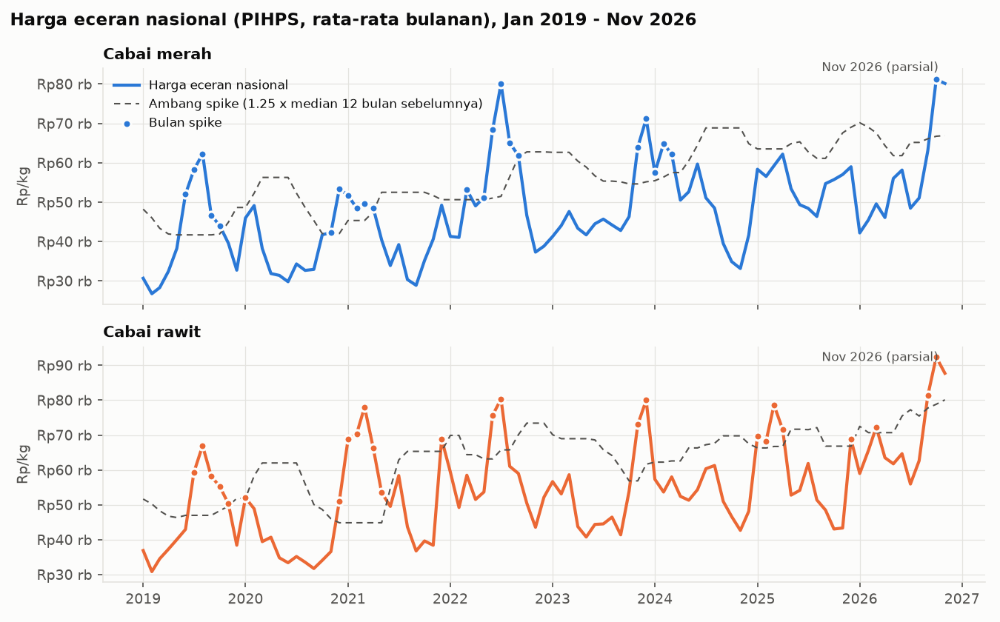
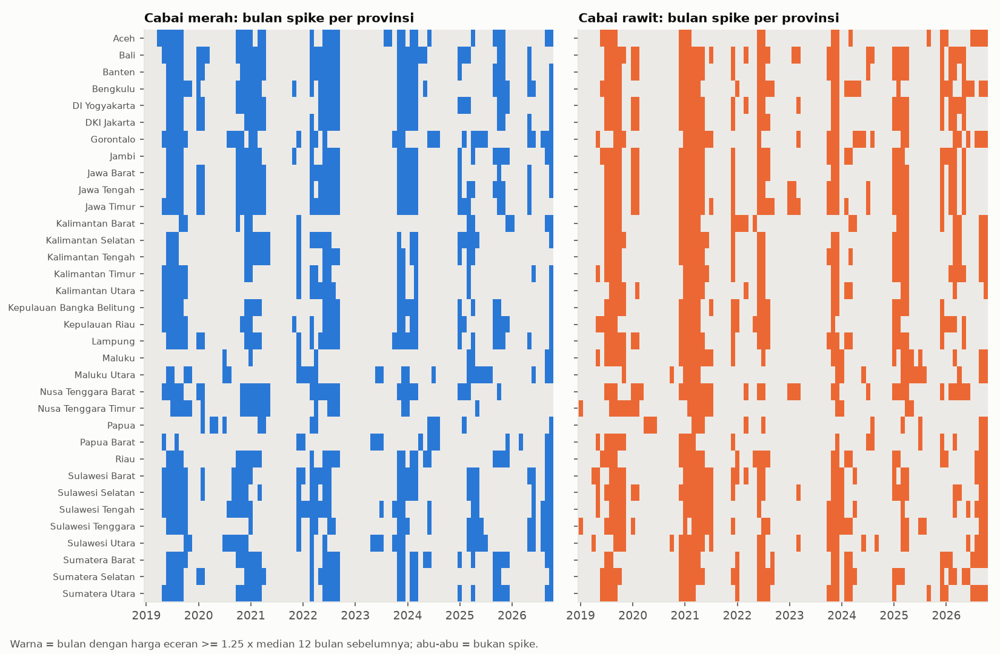
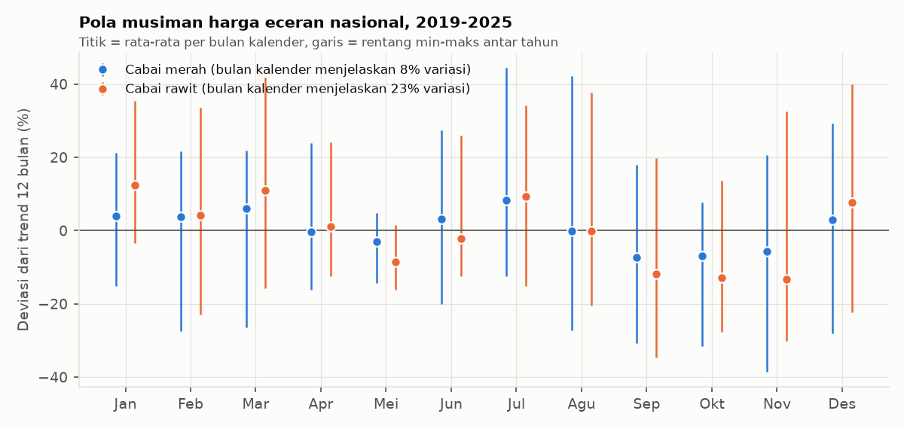
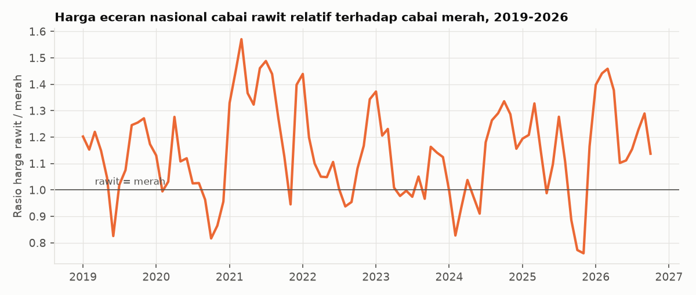

# EDA deskriptif: harga cabai 2019-2026

Hanya deskripsi: tidak ada uji hipotesis. Data: `data/final` (core dataset tervalidasi, tanpa cuaca). Harga eceran PIHPS (pasar tradisional), rata-rata bulanan dari hari kerja. Price spike = harga eceran bulanan >= 1.25 x median 12 bulan sebelumnya (trailing, tanpa look-ahead); dinilai Jan 2019 - Okt 2026; November 2026 parsial tidak dinilai.

Script: `analysis/eda.py` (definisi spike di `analysis/spikes.py`). Tabel lengkap di `analysis/tables/`.

## 1. Tren harga eceran nasional

| komoditas | rata2_rp | min_rp | maks_rp | cv_perubahan_bulanan_pct |
| --- | --- | --- | --- | --- |
| Cabai merah | 47,449.0 | 26,755.0 | 81,225.0 | 15.5 |
| Cabai rawit | 53,760.3 | 30,840.0 | 92,370.5 | 17.6 |

`cv_perubahan_bulanan_pct` = simpangan baku perubahan log bulanan (persen).

## 2. Episode price spike nasional

| commodity_group | start | end | months | peak_month | peak_ratio | peak_price |
| --- | --- | --- | --- | --- | --- | --- |
| Cabai merah | 2019-06 | 2019-10 | 5 | 2019-08 | 1.87 | 62,270.45 |
| Cabai merah | 2020-11 | 2021-04 | 6 | 2020-12 | 1.59 | 53,379.55 |
| Cabai merah | 2022-03 | 2022-03 | 1 | 2022-03 | 1.31 | 53,156.82 |
| Cabai merah | 2022-05 | 2022-09 | 5 | 2022-07 | 1.94 | 80,066.67 |
| Cabai merah | 2023-11 | 2024-03 | 5 | 2023-12 | 1.61 | 71,157.14 |
| Cabai merah | 2026-10 | 2026-10 | 1 | 2026-10 | 1.52 | 81,225.00 |
| Cabai rawit | 2019-07 | 2019-11 | 5 | 2019-08 | 1.78 | 66,961.36 |
| Cabai rawit | 2020-01 | 2020-01 | 1 | 2020-01 | 1.25 | 51,981.82 |
| Cabai rawit | 2020-12 | 2021-05 | 6 | 2021-03 | 2.17 | 78,019.57 |
| Cabai rawit | 2021-12 | 2021-12 | 1 | 2021-12 | 1.32 | 68,834.78 |
| Cabai rawit | 2022-06 | 2022-07 | 2 | 2022-07 | 1.53 | 80,364.29 |
| Cabai rawit | 2023-11 | 2023-12 | 2 | 2023-12 | 1.62 | 80,014.29 |
| Cabai rawit | 2025-01 | 2025-04 | 4 | 2025-03 | 1.47 | 78,645.24 |
| Cabai rawit | 2025-12 | 2025-12 | 1 | 2025-12 | 1.29 | 68,732.61 |
| Cabai rawit | 2026-03 | 2026-03 | 1 | 2026-03 | 1.28 | 72,304.55 |
| Cabai rawit | 2026-09 | 2026-10 | 2 | 2026-10 | 1.46 | 92,370.45 |

## 3. Episode per provinsi

Total 651 episode di 34 provinsi (cabai merah 312, cabai rawit 339).

| province | episode_merah | episode_rawit | bulan_spike_merah | bulan_spike_rawit |
| --- | --- | --- | --- | --- |
| Aceh | 12 | 8 | 30 | 19 |
| Bali | 8 | 13 | 35 | 35 |
| Banten | 9 | 11 | 30 | 27 |
| Bengkulu | 11 | 10 | 33 | 30 |
| DI Yogyakarta | 8 | 11 | 30 | 28 |
| DKI Jakarta | 9 | 10 | 26 | 26 |
| Gorontalo | 12 | 12 | 32 | 28 |
| Jambi | 10 | 10 | 29 | 30 |
| Jawa Barat | 9 | 10 | 29 | 26 |
| Jawa Tengah | 11 | 12 | 32 | 29 |
| Jawa Timur | 8 | 14 | 32 | 34 |
| Kalimantan Barat | 7 | 9 | 12 | 24 |
| Kalimantan Selatan | 8 | 8 | 24 | 25 |
| Kalimantan Tengah | 8 | 9 | 21 | 25 |
| Kalimantan Timur | 10 | 9 | 19 | 26 |
| Kalimantan Utara | 7 | 10 | 18 | 21 |
| Kepulauan Bangka Belitung | 8 | 8 | 23 | 23 |
| Kepulauan Riau | 10 | 8 | 26 | 24 |
| Lampung | 12 | 10 | 31 | 28 |
| Maluku | 6 | 11 | 8 | 27 |
| Maluku Utara | 10 | 8 | 25 | 18 |
| Nusa Tenggara Barat | 7 | 11 | 30 | 33 |
| Nusa Tenggara Timur | 7 | 5 | 20 | 18 |
| Papua | 8 | 8 | 13 | 13 |
| Papua Barat | 9 | 10 | 15 | 19 |
| Riau | 9 | 9 | 27 | 26 |
| Sulawesi Barat | 9 | 11 | 31 | 28 |
| Sulawesi Selatan | 11 | 11 | 28 | 31 |
| Sulawesi Tengah | 9 | 10 | 31 | 24 |
| Sulawesi Tenggara | 10 | 11 | 24 | 28 |
| Sulawesi Utara | 10 | 13 | 27 | 26 |
| Sumatera Barat | 11 | 9 | 30 | 22 |
| Sumatera Selatan | 9 | 10 | 24 | 30 |
| Sumatera Utara | 10 | 10 | 28 | 25 |

Bulan dengan porsi provinsi spike terbanyak (spike serentak):

| commodity_group | month | pct_provinsi_spike |
| --- | --- | --- |
| Cabai rawit | 2021-03 | 97 |
| Cabai rawit | 2021-01 | 94 |
| Cabai rawit | 2021-02 | 94 |
| Cabai rawit | 2021-04 | 91 |
| Cabai rawit | 2019-09 | 91 |
| Cabai merah | 2019-07 | 85 |
| Cabai merah | 2019-08 | 85 |
| Cabai merah | 2026-10 | 85 |
| Cabai merah | 2023-12 | 85 |
| Cabai merah | 2021-01 | 82 |

## 4. Sensitivity ambang spike

| ambang | episode_nasional_merah | episode_nasional_rawit | episode_provinsi_merah | episode_provinsi_rawit | bulan_spike_provinsi_pct |
| --- | --- | --- | --- | --- | --- |
| 1.15 | 10.00 | 12.00 | 363.00 | 413.00 | 36.19 |
| 1.25 | 6.00 | 10.00 | 312.00 | 339.00 | 27.36 |
| 1.35 | 7.00 | 6.00 | 259.00 | 278.00 | 20.84 |

Jumlah episode tidak selalu turun saat ambang naik: satu episode panjang di ambang 1,25 bisa pecah menjadi dua episode pendek di ambang 1,35 (contoh: cabai merah nasional). Porsi bulan spike provinsi turun monoton (36% -> 27% -> 21%), jadi ukuran itu lebih stabil untuk membandingkan ambang.

## 5. Pola musiman

Setelah trend 12 bulan dikeluarkan, bulan kalender menjelaskan 8% variasi deviasi log harga cabai merah dan 23% untuk cabai rawit (2019-2025). Rentang min-maks per bulan jauh lebih lebar dari rata-ratanya: lonjakan lebih banyak ditentukan kejadian tahun tertentu daripada pola musiman yang berulang. Angka ini lebih tinggi dari exploratory check di Project Charter (sekitar 2%) karena cara mengeluarkan trend berbeda (di sini rata-rata 12 bulan terpusat pada harga eceran nasional); kesimpulannya sama: musiman bukan penjelas utama, terutama untuk cabai merah.

## 6. Cabai merah vs cabai rawit

- Korelasi perubahan log bulanan harga eceran nasional merah vs rawit: 0.71.
- Tumpang tindih bulan spike provinsi (bulan dan provinsi yang sama) antara merah dan rawit: 43% dari gabungan bulan spike keduanya.

## 7. Catatan untuk analisis

- Episode didefinisikan di level harga eceran; hipotesis yang memakai harga produsen atau pedagang besar memakai episode yang sama sebagai penanda kejadian.
- Harga eceran inti tidak punya bulan imputasi; pembatasan D-44 terutama berlaku untuk harga produsen dan pedagang besar.
- Cuaca belum ada di core dataset; H1 dan H4 menunggu paket cuaca.
