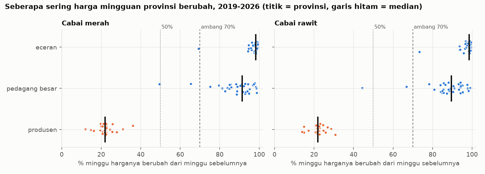
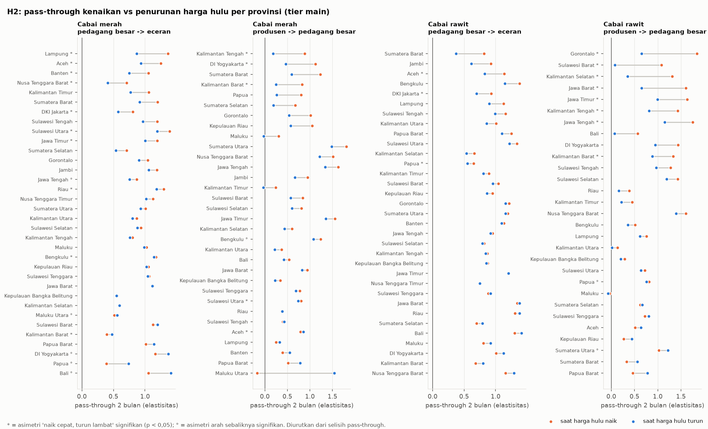
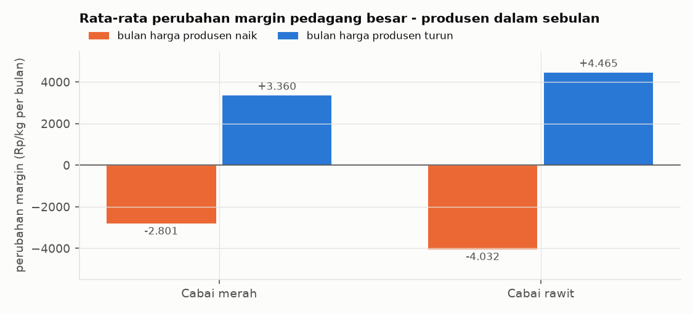

# H2: di mana lonjakan dimulai, dan apakah transmisinya asimetris? (final)

Script: `analysis/h2_transmission.py` (uji utama) dan `analysis/h2_followup.py` (kualitas data, margin, periode spike). Tabel: `analysis/tables/h2_*.csv`. Rencana: `docs/05_analysis_plan.md` bagian 3 (D-48, D-52). Data: core dataset tervalidasi, Jan 2019 - Okt 2026; data mingguan PIHPS (tidak di-impute, D-12).

**Keputusan: sebagian.**
- Untuk simpul pedagang besar -> eceran, yang datanya memadai: eceran bergerak sekitar 1 minggu lebih dulu, dan transmisinya simetris.
- Bagian yang melibatkan harga produsen (siapa yang memimpin, dan asimetri produsen -> pedagang besar) secara formal memenuhi kriteria asimetri di model panel. Namun harga produsen PIHPS hanya berubah di sekitar 22% minggu, sehingga temuan itu belum bisa dipisahkan dari irama pencatatan data.

## 1. Hasil utama dan effect size

### 1.1 Seberapa sering harga diperbarui

Persen minggu yang harganya berubah dari minggu sebelumnya, per provinsi (2019-2026):

| Komoditas | Level | Provinsi | Minimum | Median | Maksimum |
| --- | --- | --- | --- | --- | --- |
| Cabai merah | produsen | 33 | 11,9% | 22,0% | 36,0% |
| Cabai merah | pedagang besar | 34 | 49,5% | 91,3% | 98,8% |
| Cabai merah | eceran | 34 | 69,3% | 98,3% | 99,5% |
| Cabai rawit | produsen | 32 | 14,0% | 22,0% | 30,7% |
| Cabai rawit | pedagang besar | 34 | 44,4% | 89,6% | 99,0% |
| Cabai rawit | eceran | 34 | 73,3% | 98,6% | 99,5% |

Tidak ada satu provinsi pun yang harga produsennya berubah di >= 70% minggu, maupun di >= 50% minggu. Provinsi tertinggi adalah Bengkulu (36%) dan Jawa Barat (31%). Harga produsen umumnya hanya berubah sekitar sekali dalam 4-5 minggu.

### 1.2 Lead-lag mingguan

**Nasional** (cross-correlation perubahan log harga; lag positif = hulu mendahului hilir):

| Komoditas | Pasangan | Lag puncak (minggu) | 95% CI lag | Korelasi puncak | Granger hulu -> hilir (p) | Granger hilir -> hulu (p) |
| --- | --- | --- | --- | --- | --- | --- |
| Cabai merah | pedagang besar -> eceran | -1 | -1 s/d 0 | 0,62 | 0,71 | < 0,001 |
| Cabai rawit | pedagang besar -> eceran | -1 | -1 s/d 0 | 0,60 | < 0,001 | < 0,001 |
| Cabai merah | produsen -> pedagang besar | -3 | -3 s/d 0 | 0,42 | 0,64 | < 0,001 |
| Cabai rawit | produsen -> pedagang besar | -3 | -3 s/d 0 | 0,41 | 0,03 | < 0,001 |
| Cabai merah | produsen -> eceran | -3 | -4 s/d 0 | 0,33 | 0,52 | < 0,001 |
| Cabai rawit | produsen -> eceran | -3 | -3 s/d -1 | 0,38 | 0,74 | < 0,001 |

**Provinsi yang harga produsennya paling sering berubah.** Uji ini tidak bisa dijalankan sesuai aturan karena 0 provinsi lolos ambang 70% maupun 50% (dicatat di D-52). Sebagai pemeriksaan eksploratif, yang bukan pengganti aturan, saya pakai 5 provinsi dengan frekuensi tertinggi per komoditas:
- Cabai merah: Bengkulu, Jawa Barat, Jawa Timur, Sumatera Utara, Jawa Tengah (26-36%).
- Cabai rawit: Jawa Barat, Bengkulu, Jawa Timur, Jawa Tengah, Aceh (25-31%).

| Komoditas | Pasangan | Lag puncak median | Lag negatif / nol / positif | Granger: hilir memimpin / dua arah |
| --- | --- | --- | --- | --- |
| Cabai merah | pedagang besar -> eceran | -1 | 4 / 1 / 0 | 4 / 1 |
| Cabai merah | produsen -> pedagang besar | -3 | 5 / 0 / 0 | 5 / 0 |
| Cabai rawit | pedagang besar -> eceran | -1 | 3 / 2 / 0 | 3 / 2 |
| Cabai rawit | produsen -> pedagang besar | -3 | 4 / 1 / 0 | 4 / 1 |

Eceran tetap bergerak lebih dulu, termasuk di provinsi yang harga produsennya paling sering diperbarui. Tidak ada satu provinsi pun dengan lag positif.

### 1.3 Asimetri pass-through (kointegrasi -> asymmetric ECM atau first difference)

Pass-through 2 bulan, model panel provinsi tier main (FE provinsi, SE cluster provinsi):

| Komoditas | Pasangan | Saat hulu naik | Saat hulu turun | Selisih (95% CI) | p |
| --- | --- | --- | --- | --- | --- |
| Cabai merah | pedagang besar -> eceran | 0,95 | 0,94 | 0,02 (-0,06 s/d 0,09) | 0,70 |
| Cabai rawit | pedagang besar -> eceran | 1,05 | 1,03 | 0,02 (-0,02 s/d 0,06) | 0,37 |
| Cabai merah | produsen -> pedagang besar | 0,73 | 0,46 | 0,27 (0,14 s/d 0,39) | < 0,001 |
| Cabai rawit | produsen -> pedagang besar | 0,86 | 0,58 | 0,28 (0,15 s/d 0,41) | < 0,001 |

Per provinsi, porsi yang asimetri "naik cepat, turun lambat"-nya signifikan: 9-29% (tidak ada yang mencapai 50%). Rinciannya ada di `tables/h2_province_models.csv`.

**Provinsi tanpa kointegrasi** (model first difference, D-48):
- Cabai merah, pedagang besar -> eceran: Gorontalo, Kalimantan Tengah, Kalimantan Utara, Kep. Bangka Belitung, Kep. Riau, Maluku, NTT, Papua, Papua Barat, Sulawesi Tengah.
- Cabai merah, produsen -> pedagang besar: Kalimantan Barat.
- Cabai rawit, pedagang besar -> eceran: Bali, Banten, Bengkulu, Gorontalo, Jawa Barat, Kalimantan Tengah, Kep. Bangka Belitung, NTB, Papua Barat, Riau, Sulawesi Tengah, Sulawesi Tenggara, Sumatera Utara.
- Cabai rawit, produsen -> pedagang besar: Bali, Kalimantan Barat, Kalimantan Timur, Kep. Bangka Belitung, Kep. Riau.

### 1.4 Margin pedagang besar terhadap produsen

Bulan saat harga produsen turun vs naik. Bulan yang salah satu harganya hasil imputasi dikeluarkan.

| Komoditas | Arah harga produsen | Bulan | Margin rata-rata (Rp/kg) | Rasio rata-rata | Perubahan margin rata-rata (Rp/kg) | Bulan dengan margin melebar |
| --- | --- | --- | --- | --- | --- | --- |
| Cabai merah | naik | 1.513 | 8.229 | 1,33 | -2.801 | 41% |
| Cabai merah | turun | 1.361 | 6.114 | 1,31 | +3.360 | 65% |
| Cabai rawit | naik | 1.356 | 7.558 | 1,25 | -4.032 | 38% |
| Cabai rawit | turun | 1.286 | 5.522 | 1,24 | +4.465 | 67% |

Selisih bulan turun vs naik (FE provinsi, SE cluster):

| Komoditas | Ukuran | Selisih | 95% CI | p |
| --- | --- | --- | --- | --- |
| Cabai merah | perubahan margin (Rp/kg) | +6.183 | 4.952 s/d 7.414 | < 0,001 |
| Cabai merah | level margin (Rp/kg) | -1.958 | -2.674 s/d -1.242 | < 0,001 |
| Cabai merah | level rasio | -0,011 | -0,045 s/d 0,023 | 0,53 |
| Cabai rawit | perubahan margin (Rp/kg) | +8.529 | 6.167 s/d 10.892 | < 0,001 |
| Cabai rawit | level margin (Rp/kg) | -1.984 | -3.467 s/d -501 | 0,009 |
| Cabai rawit | level rasio | -0,012 | -0,061 s/d 0,037 | 0,62 |

Margin memang bertambah di bulan harga produsen turun dan berkurang di bulan harga produsen naik. Namun level margin di bulan turun tidak lebih tinggi: dalam rupiah justru lebih rendah, dan dalam rasio tidak berbeda. Artinya margin naik-turun mengimbangi harga produsen, bukan melebar secara permanen. Klaim "margin pedagang besar melebar" tidak didukung angka ini; yang didukung hanyalah "margin bergerak berlawanan arah dengan harga produsen dalam sebulan".

## 2. Keputusan terhadap aturan di rencana

| Kriteria (rencana bagian 3) | Cabai merah | Cabai rawit |
| --- | --- | --- |
| 1. Produsen atau pedagang besar Granger-mendahului eceran, arah sebaliknya tidak, puncak di lag positif | Tidak terpenuhi: eceran mendahului (nasional dan 5 provinsi eksploratif) | Tidak terpenuhi |
| 2. Asimetri di >= 50% provinsi **atau** di model panel | Terpenuhi lewat panel produsen -> pedagang besar (maksimum 29% provinsi) | Terpenuhi lewat panel produsen -> pedagang besar (maksimum 28% provinsi) |
| **Keputusan** | **Sebagian** | **Sebagian** |

Kriteria 2 hanya terpenuhi di simpul yang memakai harga produsen; lihat bagian 5 untuk batasannya.

## 3. Sensitivity check

| Pemeriksaan | Hasil |
| --- | --- |
| Tanpa bulan imputasi (D-44) | Tidak mengubah kesimpulan. Selisih pass-through panel produsen -> pedagang besar 0,28 (merah) dan 0,29 (rawit), p < 0,001; porsi provinsi rawit asimetris turun dari 28% ke 21%. Eceran tidak punya bulan imputasi |
| Tier main + descriptive | Tidak mengubah kesimpulan (selisih panel 0,27-0,29) |
| Mingguan per provinsi | Lima provinsi dengan harga produsen paling sering berubah, plus Jawa Barat, Jawa Tengah, Jawa Timur: eceran tetap mendahului |
| Periode spike harga pedagang besar (D-52), ambang 1,15 / 1,25 / 1,35 | Pedagang besar -> eceran, cabai rawit: saat pedagang besar spike, penurunan justru diteruskan **lebih** penuh daripada kenaikan (selisih -0,15 s/d -0,19, p < 0,001); di bulan lain simetris. Cabai merah: simetris di kedua periode. Produsen -> pedagang besar: asimetri cabai merah hanya muncul di bulan non-spike (0,17-0,20; p 0,008-0,07), tidak di bulan spike. Catatan: untuk pasangan ini, periode spike ditentukan dari variabel dependennya sendiri, jadi dibaca hati-hati |

## 4. Temuan yang terbukti

1. Harga eceran dan pedagang besar bergerak hampir bersamaan, dengan eceran sekitar 1 minggu lebih dulu. Ini terlihat secara nasional, di 3 provinsi sentra Jawa, dan di 5 provinsi pemeriksaan eksploratif. Kedua seri ini diperbarui hampir setiap minggu (median 90-98%).
2. Transmisi pedagang besar -> eceran simetris: kenaikan dan penurunan diteruskan hampir penuh (0,94-1,05) dan seimbang. Pengecualiannya rawit saat spike pedagang besar, ketika penurunan diteruskan lebih penuh.
3. Harga produsen PIHPS hanya berubah di sekitar 22% minggu (maksimum 36%), jauh lebih jarang daripada pedagang besar dan eceran.
4. Margin pedagang besar terhadap produsen bergerak berlawanan arah dengan harga produsen dalam sebulan (bertambah saat produsen turun, berkurang saat produsen naik), tetapi level margin tidak lebih tinggi di bulan harga produsen turun.

## 5. Dugaan yang perlu verifikasi

1. Jeda 3 minggu antara eceran dan harga produsen kemungkinan besar berasal dari irama pencatatan harga produsen yang jarang, bukan dari pasar. Verifikasi: cara dan frekuensi pengumpulan harga produsen PIHPS ke Bank Indonesia, atau sumber harga petani lain (misalnya survei harga produsen BPS).
2. Asimetri produsen -> pedagang besar (0,27-0,28) bisa ikut dibentuk oleh harga produsen yang tertinggal. Kalau harga produsen baru diperbarui setelah pasar bergerak, perubahan yang tercatat bukan perubahan yang dialami pedagang besar pada bulan itu. Verifikasi dengan data harga produsen yang diperbarui lebih sering.
3. Rawit saat spike pedagang besar: penurunan diteruskan lebih penuh ke eceran. Bisa jadi pengecer lebih cepat menurunkan harga setelah lonjakan karena takut kehilangan pembeli, tetapi ini belum diuji.

## 6. So what

Untuk membaca arah harga cabai, harga eceran dan pedagang besar di PIHPS bergerak hampir bersamaan, sehingga keduanya bisa dipakai untuk memantau. Harga produsen PIHPS terlalu jarang diperbarui untuk menjawab apakah lonjakan dimulai dari petani. Selama datanya seperti ini, pertanyaan itu belum bisa dijawab dengan yakin.

Dari pedagang besar ke pengecer, kenaikan dan penurunan diteruskan secara seimbang. Jadi tidak ada bukti pengecer "menahan" harga tinggi.

Antara petani dan pedagang besar, margin pedagang besar memang bertambah saat harga petani turun, tetapi berkurang lagi saat harga petani naik. Rata-ratanya tidak menunjukkan margin yang terus melebar.

Catatan untuk rekomendasi akhir disimpan terpisah di `analysis/notes_recommendations.md`.
