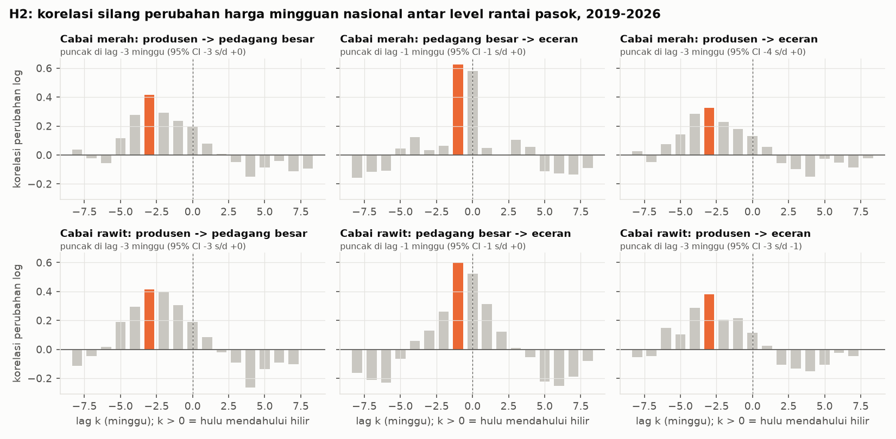

# H2: di mana lonjakan dimulai, dan apakah transmisinya asimetris?

Script: `analysis/h2_transmission.py`. Tabel: `analysis/tables/h2_*.csv`. Rencana: `docs/05_analysis_plan.md` bagian 3 (D-48). Data: core dataset tervalidasi, Jan 2019 - Okt 2026; data mingguan nasional PIHPS (tidak di-impute, D-12).

**Keputusan: sebagian.** Bagian "kenaikan dimulai di produsen atau pedagang besar" tidak didukung: data justru menunjukkan harga eceran dan pedagang besar bergerak lebih dulu, dengan catatan kualitas data harga produsen di bawah. Bagian asimetri didukung hanya di simpul produsen -> pedagang besar; pedagang besar -> eceran simetris.

## 1. Hasil utama dan effect size

### Lead-lag mingguan nasional (cross-correlation dan Granger)

Korelasi perubahan log harga mingguan pada lag -8 sampai +8 minggu. Lag positif = level hulu mendahului hilir.

| Komoditas | Pasangan | Lag puncak (minggu) | 95% CI lag (bootstrap blok) | Korelasi puncak | Granger hulu -> hilir (p) | Granger hilir -> hulu (p) |
| --- | --- | --- | --- | --- | --- | --- |
| Cabai merah | produsen -> pedagang besar | -3 | -3 s/d 0 | 0,42 | 0,64 | < 0,001 |
| Cabai merah | pedagang besar -> eceran | -1 | -1 s/d 0 | 0,62 | 0,71 | < 0,001 |
| Cabai merah | produsen -> eceran | -3 | -4 s/d 0 | 0,33 | 0,52 | < 0,001 |
| Cabai rawit | produsen -> pedagang besar | -3 | -3 s/d 0 | 0,41 | 0,03 | < 0,001 |
| Cabai rawit | pedagang besar -> eceran | -1 | -1 s/d 0 | 0,60 | < 0,001 | < 0,001 |
| Cabai rawit | produsen -> eceran | -3 | -3 s/d -1 | 0,38 | 0,74 | < 0,001 |

- Semua lag puncak **negatif**: harga eceran bergerak sekitar 1 minggu lebih dulu dari pedagang besar, dan sekitar 3 minggu lebih dulu dari harga produsen.
- Granger dari hilir ke hulu signifikan di keenam pasangan. Dari hulu ke hilir hanya signifikan untuk cabai rawit, sehingga arahnya dua arah, bukan hulu memimpin.
- Interval bootstrap untuk lag puncak menyentuh 0 di lima pasangan. Jadi yang kuat adalah "hulu tidak memimpin", sedangkan besar lagnya kurang pasti. Pengecualian: rawit produsen -> eceran, yang intervalnya seluruhnya negatif (-3 s/d -1).

**Catatan kualitas data.** Harga produsen nasional di PIHPS hanya berubah pada 27% hari kerja. Pembanding: pedagang besar 57-58%, eceran 96-97%. Seri produsen tampaknya diperbarui jauh lebih jarang, sehingga sebagian dari jeda 3 minggu bisa berasal dari irama pencatatan, bukan dari pasar. Pola yang sama muncul di data mingguan Jawa Barat, Jawa Tengah, dan Jawa Timur (lag puncak -3 untuk produsen, -1 atau 0 untuk pedagang besar). Cara pengumpulan harga produsen PIHPS perlu dicek ke Bank Indonesia sebelum hasil ini dipakai untuk kebijakan.

### Transmisi bulanan per provinsi (kointegrasi -> asymmetric ECM atau first difference)

Pass-through 2 bulan (elastisitas, jumlah efek bulan ini dan bulan lalu). Model panel gabungan provinsi tier main, FE provinsi, SE cluster provinsi:

| Komoditas | Pasangan | Provinsi | Pass-through saat hulu naik | Pass-through saat hulu turun | Selisih (95% CI) | p |
| --- | --- | --- | --- | --- | --- | --- |
| Cabai merah | produsen -> pedagang besar | 32 | 0,73 | 0,46 | 0,27 (0,14 s/d 0,39) | < 0,001 |
| Cabai merah | pedagang besar -> eceran | 34 | 0,95 | 0,94 | 0,02 (-0,06 s/d 0,09) | 0,70 |
| Cabai rawit | produsen -> pedagang besar | 29 | 0,86 | 0,58 | 0,28 (0,15 s/d 0,41) | < 0,001 |
| Cabai rawit | pedagang besar -> eceran | 33 | 1,05 | 1,03 | 0,02 (-0,02 s/d 0,06) | 0,37 |

Per provinsi, klasifikasi "naik cepat, turun lambat" dihitung dari pass-through, atau dari kecepatan koreksi saat harga hilir di atas keseimbangan:

| Komoditas | Pasangan | Provinsi | Naik cepat, turun lambat | Arah sebaliknya | Tidak signifikan / campuran | Model ECM / first difference |
| --- | --- | --- | --- | --- | --- | --- |
| Cabai merah | pedagang besar -> eceran | 34 | 10 (29%) | 5 | 19 | 24 / 10 |
| Cabai merah | produsen -> pedagang besar | 32 | 5 (16%) | 1 | 26 | 31 / 1 |
| Cabai rawit | pedagang besar -> eceran | 33 | 3 (9%) | 0 | 30 | 20 / 13 |
| Cabai rawit | produsen -> pedagang besar | 29 | 8 (28%) | 2 | 19 | 24 / 5 |

**Provinsi tanpa kointegrasi** (Engle-Granger p >= 0,05), yang memakai model asimetris first difference (D-48):
- Cabai merah, pedagang besar -> eceran (10): Gorontalo, Kalimantan Tengah, Kalimantan Utara, Kepulauan Bangka Belitung, Kepulauan Riau, Maluku, Nusa Tenggara Timur, Papua, Papua Barat, Sulawesi Tengah.
- Cabai merah, produsen -> pedagang besar (1): Kalimantan Barat.
- Cabai rawit, pedagang besar -> eceran (13): Bali, Banten, Bengkulu, Gorontalo, Jawa Barat, Kalimantan Tengah, Kepulauan Bangka Belitung, Nusa Tenggara Barat, Papua Barat, Riau, Sulawesi Tengah, Sulawesi Tenggara, Sumatera Utara.
- Cabai rawit, produsen -> pedagang besar (5): Bali, Kalimantan Barat, Kalimantan Timur, Kepulauan Bangka Belitung, Kepulauan Riau.

## 2. Keputusan terhadap aturan di rencana

| Kriteria (rencana bagian 3) | Cabai merah | Cabai rawit |
| --- | --- | --- |
| 1. Produsen atau pedagang besar Granger-mendahului eceran, arah sebaliknya tidak, puncak cross-correlation di lag positif | Tidak terpenuhi: eceran mendahului (lag -1 dan -3), Granger hilir -> hulu signifikan | Tidak terpenuhi: hubungan dua arah, puncak di lag negatif |
| 2. Asimetri "naik cepat, turun lambat" di >= 50% provinsi tier main **atau** di model panel | Terpenuhi lewat panel produsen -> pedagang besar (bukan lewat mayoritas provinsi: maksimum 29%) | Terpenuhi lewat panel produsen -> pedagang besar (maksimum 28% provinsi) |
| **Keputusan** | **Sebagian** | **Sebagian** |

Menurut kriteria charter, H2 dibantah kalau "harga eceran bergerak lebih dulu, atau transmisi simetris". Bagian pertama memang terjadi di data. Karena itu, "sebagian" di sini berarti: urutan "dimulai di hulu" dibantah (dengan catatan kualitas data harga produsen), sedangkan asimetri terbukti di satu simpul.

## 3. Sensitivity check

| Spesifikasi | Komoditas | Pasangan | Provinsi naik cepat turun lambat | Selisih pass-through panel (p) |
| --- | --- | --- | --- | --- |
| Utama (tier main) | Cabai merah | produsen -> pedagang besar | 16% | 0,27 (< 0,001) |
| Tanpa bulan imputasi (D-44) | Cabai merah | produsen -> pedagang besar | 16% | 0,28 (< 0,001) |
| Tier main + descriptive | Cabai merah | produsen -> pedagang besar | 16% | 0,27 (< 0,001) |
| Utama (tier main) | Cabai rawit | produsen -> pedagang besar | 28% | 0,28 (< 0,001) |
| Tanpa bulan imputasi (D-44) | Cabai rawit | produsen -> pedagang besar | 21% | 0,29 (< 0,001) |
| Tier main + descriptive | Cabai rawit | produsen -> pedagang besar | 26% | 0,29 (< 0,001) |
| Semua spesifikasi | Kedua komoditas | pedagang besar -> eceran | 9-29% | 0,01-0,02 (p 0,37-0,70) |

- **D-44 (tanpa bulan imputasi):** kesimpulan tidak berubah. Harga eceran tidak punya bulan imputasi. Ada 113 bulan imputasi di harga produsen dan pedagang besar; mengeluarkannya hanya menggeser porsi provinsi rawit dari 28% ke 21%.
- **Tier descriptive ikut:** tidak mengubah kesimpulan.
- **Mingguan per provinsi (Jawa Barat, Jawa Tengah, Jawa Timur):** pola lead-lag sama dengan nasional.
- **Tidak dijalankan:** analisis khusus periode spike dengan ambang 1,15/1,35, yang ada di rencana. Spike didefinisikan dari harga eceran, jadi membatasi sampel ke bulan spike sama dengan memilih sampel berdasarkan variabel dependen, dan hasil asimetrinya akan bias. Usulan pengganti dicatat di D-52.

## 4. Chart pendukung

Batang oranye = lag dengan korelasi tertinggi; semuanya di sisi kiri garis putus-putus (hilir mendahului hulu).

Titik oranye = pass-through saat harga hulu naik, biru = saat turun. Jarak yang lebar dan oranye di kanan = "naik cepat, turun lambat". Di panel produsen -> pedagang besar, oranye konsisten di kanan biru. Di pedagang besar -> eceran, keduanya hampir berimpit.

## 5. So what

Lonjakan harga cabai di data PIHPS tidak terlihat dimulai dari petani: harga di pasar eceran dan pedagang besar bergerak lebih dulu, dan harga produsen menyusul sekitar tiga minggu kemudian. Sebagian jeda ini kemungkinan karena harga produsen jarang diperbarui, jadi untuk saat ini harga produsen PIHPS belum layak jadi alarm dini. Pemantauan harian sebaiknya bertumpu pada harga pedagang besar.

Ketidakadilan harga terjadi di simpul petani ke pedagang besar. Saat harga di petani naik, sekitar 0,73-0,86 bagian kenaikannya diteruskan ke harga pedagang besar. Saat harga di petani turun, hanya 0,46-0,58 bagian yang diteruskan, sehingga margin pedagang besar melebar setelah harga turun. Dari pedagang besar ke eceran, kenaikan dan penurunan diteruskan hampir penuh dan seimbang.

Bagi TPID, intervensi untuk mempercepat turunnya harga lebih tepat diarahkan ke tingkat pedagang besar, bukan ke pengecer.
