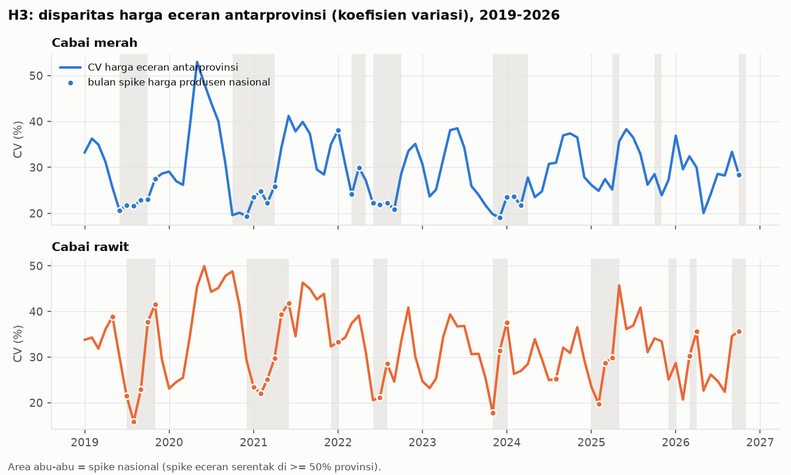
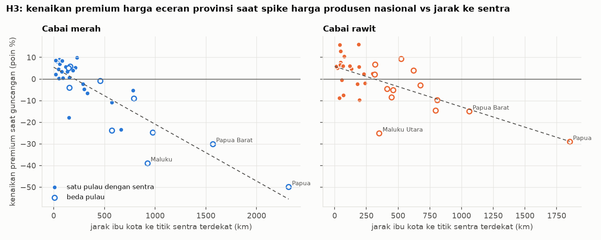

# H3: apakah disparitas harga antarprovinsi melebar saat guncangan pasokan?

Script: `analysis/h3_disparity.py`. Tabel: `analysis/tables/h3_*.csv`. Rencana: `docs/05_analysis_plan.md` bagian 4 (D-48, D-50). Data: harga eceran 34 provinsi, Jan 2019 - Okt 2026. Penanda guncangan utama: spike harga produsen nasional (1,25 x median 12 bulan): 23 bulan cabai merah, 25 bulan cabai rawit.

**Keputusan: tidak didukung (dibantah).** Saat guncangan, disparitas harga eceran antarprovinsi justru menyempit, dan provinsi yang jauh dari sentra justru mengalami penurunan premium, bukan kenaikan.

## 1. Hasil utama dan effect size

### 1.1 Koefisien variasi (CV) harga eceran antarprovinsi

Regresi CV bulanan pada dummy guncangan, FE month-of-year, dan trend (SE HAC), dengan 95% CI bootstrap blok 12 bulan:

| Komoditas | CV bulan normal | CV bulan guncangan | Efek guncangan (poin %) | 95% CI bootstrap | p (HAC) |
| --- | --- | --- | --- | --- | --- |
| Cabai merah | 31,2% | 23,9% | -8,1 | -10,8 s/d -5,7 | < 0,001 |
| Cabai rawit | 33,1% | 29,4% | -4,0 | -7,3 s/d -1,5 | 0,03 |

### 1.2 Premium provinsi vs jarak ke sentra

Premium = harga eceran provinsi / median 34 provinsi di bulan itu. Kenaikan premium = rata-rata bulan guncangan - rata-rata bulan normal. Regresi lintas 34 provinsi, SE HC3:

| Komoditas | Koefisien jarak (poin % per 100 km) | 95% CI | p | Koefisien beda pulau (poin %) | p |
| --- | --- | --- | --- | --- | --- |
| Cabai merah | -2,50 | -3,25 s/d -1,74 | < 0,001 | -2,5 | 0,54 |
| Cabai rawit | -1,72 | -2,69 s/d -0,76 | < 0,001 | -1,6 | 0,76 |

Di bulan normal, premium berkorelasi positif dengan jarak ke sentra (0,64 untuk merah, 0,62 untuk rawit). Provinsi jauh memang lebih mahal, tetapi selisih itu mengecil saat guncangan. Contoh cabai merah: premium Papua turun dari 1,70x ke 1,21x median nasional, Maluku dari 1,69x ke 1,30x.

### 1.3 Provinsi yang konsisten mahal saat spike nasional (US2)

Spike nasional = spike eceran serentak di >= 50% provinsi: 8 episode cabai merah, 9 episode cabai rawit. Provinsi yang masuk 10 premium tertinggi di banyak episode:

| Komoditas | Provinsi (episode masuk 10 teratas / total episode) |
| --- | --- |
| Cabai merah | Kalimantan Tengah (7/8), Kalimantan Utara (7/8), Kep. Bangka Belitung (7/8), Maluku (6/8), Kep. Riau (6/8), DKI Jakarta (6/8), Papua (5/8) |
| Cabai rawit | Maluku (9/9), Kalimantan Utara (9/9), Maluku Utara (8/9), Papua Barat (6/9), Kalimantan Barat (6/9), Kalimantan Tengah (6/9), DKI Jakarta (6/9) |

Daftar lengkap provinsi yang konsisten di >= 2 episode ada di `tables/h3_vulnerable_consistent.csv`. Ranking ini konsisten antar episode, sehingga memenuhi acceptance criteria US2.

## 2. Keputusan terhadap aturan di rencana

| Kriteria | Cabai merah | Cabai rawit |
| --- | --- | --- |
| CV naik signifikan saat guncangan | Tidak: turun 8,1 poin (signifikan) | Tidak: turun 4,0 poin (signifikan) |
| Kenaikan premium bertambah dengan jarak (koefisien positif, p < 0,05) | Tidak: koefisien negatif (signifikan) | Tidak: koefisien negatif (signifikan) |
| **Keputusan** | **Tidak didukung (dibantah)** | **Tidak didukung (dibantah)** |

Ini sesuai kondisi "dibantah jika" di charter: disparitas tidak melebar dan tidak berkaitan positif dengan jarak.

## 3. Sensitivity check

| Spesifikasi | Efek CV merah (pp, p) | Efek CV rawit (pp, p) | Jarak merah (pp/100 km, p) | Jarak rawit (pp/100 km, p) |
| --- | --- | --- | --- | --- |
| Utama: spike produsen 1,25 | -8,1 (< 0,001) | -4,0 (0,03) | -2,50 (< 0,001) | -1,72 (< 0,001) |
| Tanpa DKI Jakarta | -8,4 (< 0,001) | -4,0 (0,03) | -2,49 (< 0,001) | -1,73 (< 0,001) |
| Spike produsen 1,15 | -7,0 (< 0,001) | -3,0 (0,11) | -2,38 (0,001) | -1,65 (0,001) |
| Spike produsen 1,35 | -8,3 (< 0,001) | -3,5 (0,11) | -2,67 (< 0,001) | -1,73 (0,005) |
| Penanda dari spike pedagang besar 1,25 | -9,2 (< 0,001) | -5,3 (0,007) | -2,88 (< 0,001) | -2,29 (< 0,001) |

- Arah semua spesifikasi sama. Untuk rawit, efek CV tidak signifikan pada ambang 1,15 dan 1,35, tetapi tetap negatif.
- Penanda dari harga pedagang besar ditambahkan karena H2 menunjukkan harga produsen PIHPS jarang diperbarui. Hasilnya lebih kuat, bukan berbalik.
- D-44: harga eceran tidak punya bulan imputasi, sehingga tidak ada yang perlu dikeluarkan. Penanda guncangan dari harga produsen nasional juga tidak memakai bulan imputasi (seri nasional lengkap).

## 4. Temuan yang terbukti

1. Saat terjadi guncangan harga di hulu, perbedaan harga eceran antarprovinsi menyempit: CV turun 8 poin untuk cabai merah dan 4 poin untuk cabai rawit.
2. Provinsi yang jauh dari sentra secara struktural lebih mahal di bulan normal, tetapi premiumnya justru mengecil saat guncangan: sekitar 1,7-2,5 poin persen per 100 km.
3. Kelompok provinsi yang sama selalu termasuk paling mahal saat spike nasional: Maluku, Maluku Utara, Kalimantan Utara, Kalimantan Tengah, Papua/Papua Barat, Kep. Bangka Belitung, Kep. Riau, dan DKI Jakarta.
4. Beda pulau tidak menambah penjelasan setelah jarak dikontrol (p 0,54 dan 0,76).

## 5. Dugaan yang perlu verifikasi

1. Penyempitan disparitas kemungkinan terjadi karena harga di provinsi dekat sentra (dan sentra sendiri) melonjak lebih tinggi saat guncangan, sedangkan harga di provinsi jauh sudah tinggi dan bergerak lebih lambat. Verifikasi: bandingkan kenaikan harga absolut (persen) per provinsi per episode, bukan hanya premium relatif.
2. Premium tinggi di provinsi jauh mungkin mencerminkan ongkos angkut dan rantai distribusi yang panjang, yang relatif tetap. Data arus distribusi dan biaya angkut tidak tersedia (charter); jarak hanya proxy.
3. DKI Jakarta masuk daftar provinsi mahal meski dekat sentra Jawa Barat (132 km). Ini bisa terkait biaya ritel atau komposisi pasar yang disurvei, dan belum diuji.

## 6. So what

Pertanyaan bisnisnya: kenapa daerah tertentu tetap mahal saat produksi nasional cukup? Data menunjukkan daerah jauh dari sentra memang selalu lebih mahal, tetapi bukan karena lonjakan memukul mereka lebih keras. Saat harga nasional melonjak, justru daerah dekat sentra yang mengejar, sehingga selisih antardaerah mengecil.

Jadi "daerah tetap mahal" adalah persoalan struktural sepanjang tahun, terutama di Maluku, Papua, dan Kalimantan, bukan efek tambahan dari guncangan. Lonjakan harga cabai lebih tepat dipahami sebagai kejadian nasional yang menaikkan harga di hampir semua provinsi bersamaan.
