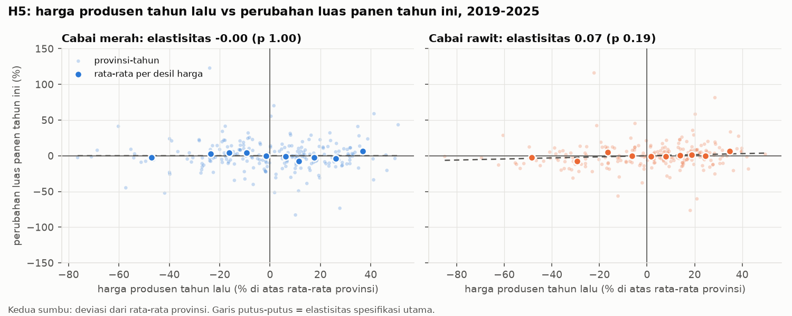

# H5: apakah harga tinggi mendorong petani menanam lebih luas (cobweb)?

Script: `analysis/h5_cobweb.py`. Tabel: `analysis/tables/h5_results.csv`. Rencana: `docs/05_analysis_plan.md` bagian 5 (D-48). Data: `core_province_year` 2018-2025. Perubahan luas panen 2019-2025 dibandingkan dengan harga produsen rata-rata tahun sebelumnya (2018-2024).

**Keputusan: tidak didukung.** Cabai merah tidak menunjukkan hubungan sama sekali. Cabai rawit menunjukkan arah positif yang konsisten di semua spesifikasi, tetapi tidak signifikan di spesifikasi utama.

## 1. Hasil utama dan effect size

Panel FE provinsi: Δ log luas panen_t pada log harga produsen_(t-1), SE cluster provinsi. Sampel:
- Cabai merah: 32 provinsi, 223 provinsi-tahun.
- Cabai rawit: 31 provinsi, 217 provinsi-tahun.
- Dikeluarkan: NTT (D-03), DKI Jakarta (seri harga produsen tier excluded), dan Jambi untuk rawit (excluded).

| Komoditas | Outcome | Elastisitas | 95% CI | p |
| --- | --- | --- | --- | --- |
| Cabai merah | luas panen | -0,000 | -0,135 s/d 0,134 | 1,00 |
| Cabai merah | produksi | -0,049 | -0,221 s/d 0,122 | 0,57 |
| Cabai rawit | luas panen | 0,075 | -0,037 s/d 0,187 | 0,19 |
| Cabai rawit | produksi | 0,043 | -0,165 s/d 0,251 | 0,69 |

Cara membaca: elastisitas 0,075 berarti harga produsen tahun lalu yang 10% lebih tinggi dari rata-rata provinsinya diikuti luas panen sekitar 0,75% lebih luas tahun ini. Angka itu kecil, dan intervalnya mencakup nol.

## 2. Keputusan terhadap aturan di rencana

| Kriteria | Cabai merah | Cabai rawit |
| --- | --- | --- |
| Koefisien positif dan signifikan di spesifikasi utama | Tidak (-0,000; p 1,00) | Tidak (0,075; p 0,19) |
| Tanda tetap positif di semua sensitivity | Tidak | Ya |
| **Keputusan** | **Tidak didukung** | **Tidak didukung; arah positif konsisten (indikatif)** |

## 3. Sensitivity check (outcome luas panen)

| Spesifikasi | Merah: elastisitas (p) | Rawit: elastisitas (p) |
| --- | --- | --- |
| Utama (FE provinsi) | -0,000 (1,00) | 0,075 (0,19) |
| Tanpa `is_outlier` di tahun t atau t-1 (D-37) | 0,033 (0,59) | 0,113 (0,02) |
| Tanpa 2025 (D-40) | 0,005 (0,95) | 0,078 (0,10) |
| Harga t-1 dari >= 9 bulan | -0,101 (0,43) | 0,084 (0,37) |
| Harga t-1 tanpa bulan imputasi (D-44) | -0,001 (0,99) | 0,071 (0,24) |
| Pembanding: + year FE | 0,129 (0,25) | 0,061 (0,45) |

Year FE menyerap variasi harga nasional, sehingga spesifikasi itu hanya memakai perbedaan antarprovinsi (D-48). Hasilnya tidak mengubah kesimpulan.

## 4. Temuan yang terbukti

1. Untuk cabai merah, tidak ada hubungan antara harga produsen tahun lalu dan perubahan luas panen maupun produksi tahun ini: elastisitas mendekati nol di semua spesifikasi.
2. Untuk cabai rawit, arah hubungannya positif di keenam spesifikasi (0,06-0,11), tetapi hanya signifikan setelah provinsi-tahun outlier produktivitas dikeluarkan (0,113; p 0,02).
3. Pengecualian 2025 (angka preliminary) dan bulan imputasi tidak mengubah hasil.

## 5. Dugaan yang perlu verifikasi

1. Respons cobweb pada cabai rawit mungkin ada tetapi kecil, dan tidak terdeteksi karena sampelnya pendek: 7 tahun perubahan, sekitar 31 provinsi. Verifikasi: data luas tanam bulanan (SPH-SBS, diminta lewat PST BPS, charter) akan lebih tepat daripada luas panen tahunan.
2. Cabai adalah tanaman berumur pendek (panen 3-4 bulan setelah tanam), sehingga respons tanam terhadap harga bisa terjadi dalam tahun yang sama dan tidak tertangkap di data tahunan. Verifikasi butuh data luas tanam bulanan.
3. Harga produsen tahunan dihitung dari seri yang jarang diperbarui (H2). Rata-rata tahunan lebih tahan terhadap masalah ini daripada data mingguan, tetapi tidak sepenuhnya.

## 6. So what

Dengan data tahunan yang tersedia, tidak terlihat pola "harga tinggi tahun ini, petani ramai menanam, harga jatuh tahun depan" yang kuat. Untuk cabai merah, polanya tidak ada sama sekali. Untuk cabai rawit, ada kecenderungan kecil ke arah itu, tetapi belum cukup kuat untuk disebut temuan.

Penjelasan "petani ikut-ikutan menanam" sebagai penyebab siklus lonjakan belum bisa dipegang. Kalau dugaan ini penting untuk keputusan, yang dibutuhkan adalah data luas tanam bulanan, bukan analisis tambahan atas data tahunan.
