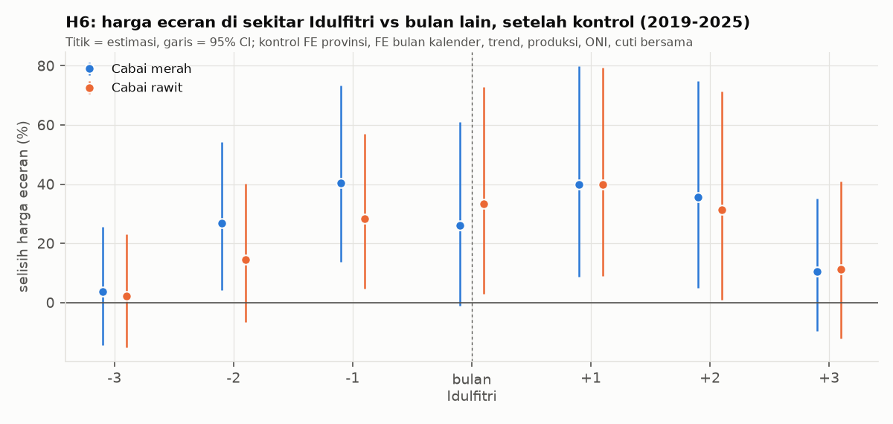

# H6: seberapa besar hari besar menambah kenaikan harga? (final)

Script: `analysis/h6_holidays.py`. Tabel: `analysis/tables/h6_*.csv`. Rencana: `docs/05_analysis_plan.md` bagian 6 (D-48). Data: harga eceran 34 provinsi, Jan 2019 - Des 2025 untuk spesifikasi utama, karena kontrol produksi 2026 belum ada. Ada 7 Idulfitri dalam sampel: Juni 2019, Mei 2020, Mei 2021, Mei 2022, April 2023, April 2024, Maret 2025.

**Keputusan final (D-62): sebagian.**
- Bagian **"bukan pemicu utama" didukung**. Di model yang sama, cuaca kering di sentra punya efek terukur terhadap harga eceran, sekitar +6% untuk anomali -1 selama empat bulan (p 0,02 dan 0,008). Efek bulan Idulfitri tidak bisa dibedakan dari nol.
- Bagian **"menambah kenaikan" tidak didukung**. Bulan Idulfitri tidak lebih mahal dari bulan lain, juga setelah anomali hujan dikontrol.

## 1. Hasil utama dan effect size

Panel FE provinsi x bulan: log harga eceran pada dummy bulan Idulfitri dan bulan sebelum Idulfitri, dengan FE provinsi, FE month-of-year, dan trend. Log produksi tahunan provinsi, ONI, dan jumlah hari cuti bersama masuk sebagai kontrol, dengan SE cluster per tahun-bulan.

| Komoditas | Bulan Idulfitri: efek (95% CI) | p | Bulan sebelum Idulfitri: efek (95% CI) | p |
| --- | --- | --- | --- | --- |
| Cabai merah | -4,6% (-20,7 s/d 14,8) | 0,62 | +12,5% (0,0 s/d 26,6) | 0,05 |
| Cabai rawit | +3,6% (-16,7 s/d 28,9) | 0,75 | +7,9% (-4,7 s/d 22,2) | 0,23 |

**Pemeriksaan pendukung (event study, di luar rencana):** dummy untuk bulan -3 sampai +3 dari Idulfitri, dengan kontrol yang sama dan pembanding semua bulan lain.

Harga di jendela -2 sampai +2 bulan rata-rata 15-46% lebih tinggi daripada bulan di luar jendela. Pola ini tetap ada setelah FE tahun ditambahkan. Karena pembanding uji utama ikut memuat bulan -2, +1, dan +2 yang juga tinggi, uji utama tidak menangkap kenaikan di jendela yang lebih lebar ini. Cara membaca angka ini ada di bagian 5.

## 2. Keputusan terhadap aturan di rencana

| Kriteria | Cabai merah | Cabai rawit |
| --- | --- | --- |
| Efek bulan Idulfitri positif dan signifikan | Tidak (-4,6%; p 0,62) | Tidak (+3,6%; p 0,75) |
| Efek hari besar lebih kecil dari efek cuaca (model yang sama, provinsi bertitik sentra) | Ya untuk bulan Idulfitri (-1,8% vs +5,8%); bulan sebelum Idulfitri lebih besar secara titik (+15,9%), tetapi p 0,09 | Tidak bisa dipastikan: titik +8,1% vs +6,0%, tetapi efek Idulfitri p 0,53 |
| Efek hari besar sebesar atau lebih besar dari cuaca (syarat dibantah) | Tidak terbukti | Tidak terbukti (interval efek Idulfitri -15% s/d +38%) |
| **Keputusan final** | **Sebagian: bukan pemicu utama (didukung); menambah kenaikan (tidak didukung)** | **Sama** |

## 2a. Perbandingan dengan efek cuaca (keputusan final, D-62)

Spesifikasi utama diulang di provinsi bertitik sentra (14 provinsi merah, 15 rawit; 2019-2025), dengan tambahan anomali hujan lag 1-4 sebagai kontrol (D-58). Efek cuaca dihitung di model yang sama, dalam satuan yang sama dengan efek Idulfitri: persen harga eceran untuk kondisi lebih kering dari normal (anomali -1) yang bertahan empat bulan.

| Komoditas | Bulan Idulfitri (95% CI) | Bulan sebelum Idulfitri (p) | Anomali hujan -1 selama 4 bulan (95% CI) |
| --- | --- | --- | --- |
| Cabai merah | -1,8% (-22,4 s/d 24,3), p 0,88 | +15,9% (0,09) | **+5,8% (0,9 s/d 10,9), p 0,02** |
| Cabai rawit | +8,1% (-15,1 s/d 37,7), p 0,53 | +10,7% (0,15) | **+6,0% (1,5 s/d 10,7), p 0,008** |

- Kontrol hujan praktis tidak mengubah efek Idulfitri (merah -2,5% menjadi -1,8%; rawit +4,7% menjadi +8,1%), jadi cuaca bukan faktor pengganggu bagi estimasi hari besar.
- Efek cuaca terhadap harga eceran searah dengan H1 (lebih kering, lebih mahal), dan untuk merah di sini signifikan. Ini berbeda dari H1 yang memakai harga produsen dan tidak menemukan efek untuk merah. Lihat bagian 5.
- Event study dengan kontrol hujan (`h6_event_study_rain.csv`) hampir sama dengan tanpa kontrol hujan. Jendela -2 s/d +2 bulan tetap 20-70% lebih mahal di provinsi sentra. Cuaca tidak menjelaskan pola jendela Lebaran.

## 3. Sensitivity check

| Spesifikasi | Merah: bulan Idulfitri (p) | Merah: bulan sebelum (p) | Rawit: bulan Idulfitri (p) | Rawit: bulan sebelum (p) |
| --- | --- | --- | --- | --- |
| Utama (2019-2025, kontrol produksi + ONI + cuti) | -4,6% (0,62) | +12,5% (0,05) | +3,6% (0,75) | +7,9% (0,23) |
| Tanpa kontrol produksi, sampai Okt 2026 (8 Idulfitri) | -8,8% (0,36) | +7,3% (0,28) | +2,7% (0,80) | +6,0% (0,33) |
| Hanya bulan `cuti_bersama_verified` | +17,6% (0,09) | +15,9% (0,02) | +34,9% (0,001) | +11,2% (0,17) |
| Tanpa 2020 | +3,4% (0,72) | +14,0% (0,03) | +8,1% (0,55) | +7,0% (0,38) |
| Tanpa kontrol cuti bersama | +6,1% (0,48) | +8,5% (0,22) | +3,7% (0,61) | +7,9% (0,27) |
| Tambah FE tahun | -3,9% (0,63) | +12,9% (0,04) | +5,3% (0,61) | +8,0% (0,22) |
| Provinsi bertitik sentra, tanpa kontrol hujan | -2,5% (0,83) | +16,2% (0,08) | +4,7% (0,72) | +10,6% (0,16) |
| Provinsi bertitik sentra + anomali hujan lag 1-4 (D-62) | -1,8% (0,88) | +15,9% (0,09) | +8,1% (0,53) | +10,7% (0,15) |

- Hasil tidak stabil. Efek bulan Idulfitri hanya signifikan di subsampel bulan dengan cuti bersama terverifikasi. Subsampel itu membuang 2020 dan beberapa bulan Idulfitri, sehingga hanya tersisa 6 kejadian.
- Bulan sebelum Idulfitri untuk cabai merah positif dan signifikan atau hampir signifikan di 5 dari 6 spesifikasi (+7 sampai +16%).
- Tidak dijalankan: dummy Natal-Tahun Baru terpisah, yang ada di rencana. Natal dan Tahun Baru selalu jatuh di Desember-Januari, sehingga efeknya sepenuhnya terserap FE month-of-year dan tidak bisa diestimasi terpisah (dicatat di D-54).
- D-44: harga eceran tidak punya bulan imputasi, sehingga tidak ada yang perlu dikeluarkan.

## 4. Temuan yang terbukti

1. Pada uji yang direncanakan, harga eceran di bulan Idulfitri tidak berbeda signifikan dari bulan lain, untuk kedua komoditas.
2. Untuk cabai merah, bulan sebelum Idulfitri cenderung lebih mahal sekitar 12-13% (p 0,04-0,05 di spesifikasi utama dan dengan FE tahun).
3. Efek hari besar sangat bergantung pada spesifikasi. Dengan hanya 7-8 kejadian Idulfitri, estimasi efeknya tidak presisi (interval kepercayaan sekitar +-20 poin persen).
4. Di provinsi bertitik sentra, kemarau yang lebih kering dari normal (anomali -1 selama empat bulan) diikuti harga eceran sekitar 6% lebih tinggi (p 0,02 merah, 0,008 rawit). Efek bulan Idulfitri tetap tidak bisa dibedakan dari nol setelah kontrol hujan.

## 5. Dugaan yang perlu verifikasi

1. Jendela sekitar Idulfitri yang mahal (event study). Kenaikan 15-46% di bulan -2 sampai +2 kemungkinan bercampur dengan episode spike besar yang kebetulan jatuh dekat Idulfitri: Juni-Oktober 2019, Januari-Mei 2021 (rawit), Mei-September 2022, Januari-April 2025 (rawit). Dengan 7 kejadian, efek hari besar dan kebetulan waktu tidak bisa dipisahkan. EDA juga menunjukkan puncak harga tidak jatuh di bulan Lebaran (D-06). **Pembaruan (D-62):** kontrol anomali hujan lag 1-4 tidak mengubah pola jendela ini, jadi cuaca di sentra bukan penjelasannya. Penjelasan yang tersisa adalah kebetulan waktu dengan episode spike atau faktor lain di sekitar Lebaran (permintaan selama Ramadan, distribusi). Verifikasi: event study per tahun Idulfitri, untuk melihat apakah pola ini datang dari satu-dua tahun saja.
2. Efek di subsampel cuti bersama terverifikasi (+35% rawit) kemungkinan efek komposisi sampel, karena tahun dan bulan yang dibuang tidak acak. Verifikasi: lengkapi data cuti bersama 2020 dan Natal 2018, 2019, 2022 dari dokumen SKB.

## 6. So what

Kepercayaan umum bahwa harga cabai melonjak karena Lebaran tidak didukung uji utama: bulan Lebaran sendiri tidak lebih mahal setelah musim, tren, dan pasokan dikontrol. Ada tanda bahwa cabai merah lebih mahal sekitar sebulan sebelum Lebaran, saat orang mulai berbelanja.

Harga di periode sekitar Lebaran memang sering tinggi, dan pola itu tidak hilang setelah cuaca dikontrol. Namun dengan tujuh Lebaran, belum bisa dipastikan apakah itu efek Lebaran atau kebetulan waktu. Sebaliknya, cuaca kering di sentra punya efek yang terukur dan konsisten: sekitar 6% di harga eceran untuk kemarau yang lebih kering dari biasanya selama beberapa bulan.

Artinya, perencanaan stok dan intervensi lebih tepat diarahkan pada pemantauan kondisi cuaca di sentra daripada pada kalender Lebaran saja.
