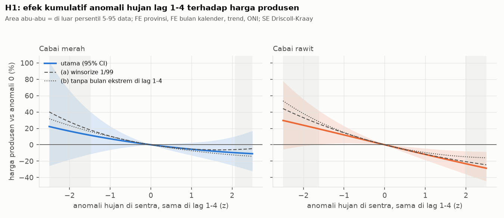
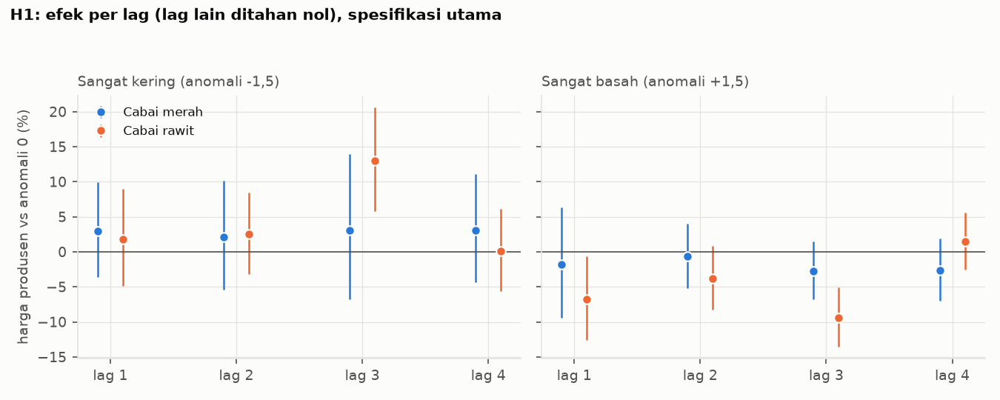

# H1: apakah hujan ekstrem di sentra menaikkan harga produsen, dan berapa lag-nya?

Script: `analysis/h1_weather.py`. Tabel: `analysis/tables/h1_*.csv`. Rencana: `docs/05_analysis_plan.md` bagian 7 (D-48), dengan ketentuan tambahan D-58.

Data:
- harga produsen bulanan, tier `main`, Jan 2019 - Okt 2026, di provinsi bertitik sentra (14 provinsi per komoditas, 1.302 observasi);
- anomali hujan di kabupaten sentra (D-58).

**Keputusan:**
- **Cabai rawit: sebagian.** Hujan di sentra berhubungan konsisten dengan harga produsen sekitar 3 bulan kemudian. Bentuknya searah, bukan U: musim yang lebih kering dari normal menaikkan harga, sedangkan musim yang lebih basah justru menurunkannya.
- **Cabai merah: tidak didukung.** Tidak ada hubungan yang signifikan. Arah estimasinya sama dengan rawit.
- **Pola U (kedua ekstrem menaikkan harga) tidak didukung untuk kedua komoditas,** termasuk di sensitivity (a) dan (b).

## 1. Hasil utama dan effect size

Variabel cuaca (D-58):
- `rain_anomaly` adalah z-score hujan bulanan per lokasi × bulan kalender, terhadap baseline 1991-2020. Hujan diakarkuadratkan dulu supaya bulan kemarau dengan normal hampir nol tidak meledak.
- Nilai per lokasi lalu dirata-rata berbobot produksi kabupaten sentra di provinsi itu.
- Nilai -1 berarti sekitar satu simpangan baku lebih kering dari normal untuk bulan itu. Untuk provinsi dengan banyak titik sentra (Jawa), satu unit sedikit lebih besar dari satu SD provinsi, karena rata-rata beberapa lokasi lebih halus.

Model panel provinsi × bulan:
- log harga produsen pada anomali lag 1-4 dan kuadratnya;
- FE provinsi, FE month-of-year, trend linear, dan ONI;
- SE Driscoll-Kraay (maxlags 6).

Efek di tabel adalah efek kumulatif dari anomali yang sama di keempat lag, artinya kondisi kering atau basah yang bertahan sekitar 4 bulan, dibanding anomali 0.

| Komoditas | Uji gabungan lag 1-4 (p) | Uji gabungan 4 suku kuadrat (p) | Kering, anomali -1,5 (95% CI) | Basah, anomali +1,5 (95% CI) |
| --- | --- | --- | --- | --- |
| Cabai merah | 0,62 | 0,99 | +11,7% (-11,5 s/d 40,9), p 0,35 | -7,7% (-18,7 s/d 4,9), p 0,22 |
| Cabai rawit | < 0,001 | 0,27 | +18,0% (1,0 s/d 37,8), p 0,04 | -17,6% (-27,4 s/d -6,5), p 0,003 |

Suku kuadrat tidak signifikan, jadi spesifikasi linear (tanpa kuadrat) dipakai untuk effect size yang lebih mudah dibaca:

| Komoditas | Anomali -1 di lag 1-4 (95% CI) | Anomali +1 di lag 1-4 (95% CI) | p |
| --- | --- | --- | --- |
| Cabai merah | +6,2% (-2,7 s/d 15,8) | -5,8% (-13,7 s/d 2,7) | 0,18 |
| Cabai rawit | +12,9% (4,2 s/d 22,3) | -11,4% (-18,2 s/d -4,0) | 0,003 |

Kurva rawit hampir lurus dan menurun, tanpa lengkungan ke atas di sisi basah. Garis putus-putus (a) dan titik-titik (b) mengikuti arah yang sama.

**Sensitivity dari rencana: kategori kering/basah.** Dummy kering (anomali < -1) dan basah (anomali > +1) di lag 1-4 dipakai menggantikan kuadrat. Sekitar 14% bulan tergolong kering dan 22-25% basah. Periode 2019-2026 memang sedikit lebih basah dari normal: rata-rata anomali +0,22 (merah) dan +0,15 (rawit).

| Komoditas | Empat bulan berturut-turut kering (95% CI) | Uji gabungan (p) | Empat bulan berturut-turut basah (95% CI) | Uji gabungan (p) |
| --- | --- | --- | --- | --- |
| Cabai merah | +31,6% (3,0 s/d 68,3), p 0,03 | 0,20 | +4,5% (-15,4 s/d 28,9), p 0,68 | 0,98 |
| Cabai rawit | +30,8% (10,0 s/d 55,6), p 0,002 | 0,001 | -10,5% (-25,0 s/d 6,8), p 0,22 | 0,005 |

**Jalur produksi (tahunan, D-42).** Perubahan log produksi BDSP dimodelkan terhadap rata-rata anomali tahunan dan rata-rata kuadratnya, dengan FE tahun dan SE cluster per provinsi (sekitar 100 provinsi-tahun per komoditas).
- Tidak ada koefisien yang signifikan, baik di spesifikasi utama, tanpa 2025 (preliminary), maupun tanpa outlier produktivitas.
- Satu-satunya tanda: rawit tanpa 2025 punya suku kuadrat negatif (tahun dengan hujan lebih ekstrem, produksi tumbuh lebih rendah), dengan p 0,08.
- Dengan data tahunan, jalur "hujan ekstrem → produksi turun" tidak bisa dikonfirmasi.

**ONI.** Di spesifikasi utama, ONI tidak berpengaruh langsung terhadap harga produsen: sekitar -1% per unit, p 0,87 untuk kedua komoditas. Anomali hujan lokal sudah ada di model, jadi bagian efek El Niño/La Niña yang bekerja lewat hujan di sentra terbaca di variabel hujan, bukan di ONI.

## 2. Keputusan terhadap aturan di rencana

Aturan (rencana bagian 7 dan D-58):
- **Didukung** kalau 4 suku kuadrat signifikan bersama (p < 0,05), jumlahnya positif, dan efek kumulatif positif di anomali -1,5 maupun +1,5.
- Pola U hanya diklaim kalau bertahan di sensitivity (a) dan (b).
- **Dibantah** kalau tidak ada perbedaan harga yang konsisten antara bulan anomali dan normal di semua lag.

| Kriteria | Cabai merah | Cabai rawit |
| --- | --- | --- |
| Suku kuadrat signifikan bersama | Tidak (p 0,99) | Tidak (p 0,27) |
| Jumlah koefisien kuadrat positif | Hampir nol (+0,007) | Hampir nol (-0,006) |
| Efek positif di kedua ekstrem | Tidak: kering +11,7%, basah -7,7% | Tidak: kering +18,0%, basah -17,6% |
| Pola U bertahan di (a) dan (b) | Tidak | Tidak |
| Ada perbedaan harga konsisten antara bulan anomali dan normal | Tidak (uji gabungan p 0,62) | Ya (p < 0,001; tahan di semua sensitivity) |
| Lag terbesar di 1-4 bulan | Tidak ada lag yang signifikan | Ya, lag 3 |
| **Keputusan** | **Tidak didukung** | **Sebagian**: kering → harga naik (lag sekitar 3 bulan) didukung; basah → harga naik dibantah (arahnya kebalikan); pola U tidak didukung |

## 3. Sensitivity check

Efek kumulatif lag 1-4, spesifikasi kuadrat kecuali disebut lain:

| Spesifikasi | Merah: kering -1,5 (p) | Merah: basah +1,5 (p) | Rawit: kering -1,5 (p) | Rawit: basah +1,5 (p) | Suku kuadrat p (merah / rawit) |
| --- | --- | --- | --- | --- | --- |
| Utama | +11,7% (0,35) | -7,7% (0,22) | +18,0% (0,04) | -17,6% (0,003) | 0,99 / 0,27 |
| (a) Winsorize persentil 1/99 | +18,3% (0,12) | -6,2% (0,36) | +23,3% (0,008) | -16,4% (0,010) | 0,83 / 0,30 |
| (b) Tanpa bulan ekstrem di lag 1-4 | +16,3% (0,08) | -10,1% (0,21) | +25,5% (0,003) | -12,6% (0,10) | 0,58 / 0,76 |
| (a) + (b) | +17,1% (0,07) | -9,8% (0,22) | +25,9% (0,004) | -12,5% (0,11) | 0,63 / 0,73 |
| (c) Tanpa bulan imputasi (D-44) | +11,8% (0,35) | -7,8% (0,21) | +18,0% (0,04) | -17,4% (0,003) | 0,98 / 0,28 |
| (d) FE tahun-bulan (D-48) | -3,8% (0,58) | -0,8% (0,79) | +8,5% (0,06) | -6,0% (0,09) | 0,43 / 0,007* |
| z-score biasa (tanpa akar) | +14,1% (0,27) | -7,3% (0,21) | +22,2% (0,02) | -14,4% (0,006) | 0,83 / 0,02* |
| Tanpa ONI | +11,3% (0,36) | -7,5% (0,25) | +18,9% (0,02) | -18,2% (0,015) | 0,99 / 0,23 |
| Lag 0-6 (efek lag 1-4) | +9,7% (0,45) | -6,2% (0,29) | +17,5% (0,04) | -17,1% (0,002) | 1,00 / 0,17 |
| Outcome harga pedagang besar | +16,8% (0,10) | -3,2% (0,53) | +9,9% (0,13) | -7,9% (0,11) | 0,49 / 0,73 |

Catatan:
- **\*** Di (d) dan z-score biasa, suku kuadrat rawit signifikan bersama karena suku lag 3 positif, tetapi suku lag 1 negatif dan jumlahnya kecil (+0,005 dan +0,010). Efek di sisi basah tetap negatif, jadi tidak membentuk U.
- **(a) dan (b), syarat klaim U:** pola U tidak muncul. Untuk rawit, efek kering justru menguat (+23% dan +26%). Efek basah melemah di (b) (p 0,10), yang berarti sebagian efek basah datang dari bulan-bulan ekstrem.
- **(c) D-44:** hanya 10-13 bulan imputasi harga produsen di sampel ini, sehingga hasilnya praktis sama.
- **(d) FE tahun-bulan:** semua guncangan nasional diserap, termasuk ENSO dan harga nasional. Efek rawit mengecil menjadi sekitar setengahnya (+8,5% / -6,0%; di anomali -1 dan +1: +5,4% dan -4,2%, p 0,03 dan 0,04). Lag 3 tetap paling kuat (p < 0,001). Artinya sekitar separuh efek di spesifikasi utama berasal dari kondisi hujan yang serentak di banyak sentra, dan separuhnya dari perbedaan hujan antarprovinsi.
- **Pemeriksaan pendukung (di luar rencana), leave-one-out pada spesifikasi linear rawit** (`h1_leave_one_out.csv`): membuang satu tahun atau satu provinsi mana pun, efek kering -1 tetap +6,5% sampai +15,5% (semua p ≤ 0,014), dan koefisien lag 3 selalu p < 0,001. Efek terkecil muncul saat 2019 dibuang. Untuk merah, tidak ada satu pun yang signifikan.

## 4. Lag terkuat per komoditas (bahan pemilihan sinyal H4)

Lag terkuat = lag dengan statistik uji gabungan (linear + kuadrat) terbesar di spesifikasi utama (D-58).

| Komoditas | Lag terkuat | Uji lag itu (chi2; p) | Efek lag itu saja: kering -1,5 / basah +1,5 (95% CI) | Konsisten di sensitivity |
| --- | --- | --- | --- | --- |
| Cabai merah | Lag 3 (nominal) | 1,8; p 0,41 | +3,0% (-6,8 s/d 13,9) / -2,7% (-6,7 s/d 1,5) | Tidak ada lag yang signifikan di spesifikasi mana pun (p terkecil 0,08, lag 1 di FE tahun-bulan) |
| Cabai rawit | **Lag 3** | 19,1; p < 0,001 | +13,0% (5,8 s/d 20,6) / -9,4% (-13,5 s/d -5,1) | Ya: lag 3 p < 0,001 di (a), (b), (c), (d), z-score biasa, tanpa ONI, lag 0-6, dan leave-one-out |

Untuk harga pedagang besar rawit, lag terkuat adalah **lag 2** (chi2 15,2; p 0,001), dengan lag 3 dan 4 juga signifikan.

Implikasi untuk H4 (sinyal: harga pedagang besar, cuaca, ONI):
- **Rawit:** anomali hujan sentra lag 2-3 adalah kandidat sinyal. Target H4 dihitung t+1/t+2, jadi anomali bulan t dan t-1 sudah memberi lead time sekitar 2-3 bulan sebelum dampak di harga.
- **Merah:** belum ada dasar memilih lag cuaca. Usulan: H4 merah tetap mencoba lag 1-4 di dalam backtest, tanpa prioritas lag tertentu.

## 5. Temuan yang terbukti

1. **Pola U tidak ada.** Untuk kedua komoditas, hujan yang jauh lebih basah dari normal tidak menaikkan harga produsen 1-4 bulan kemudian. Hasil ini bertahan setelah winsorize dan setelah bulan ekstrem dikeluarkan.
2. **Cabai rawit: musim lebih kering dari normal di sentra berasosiasi dengan harga produsen lebih tinggi sekitar 3 bulan kemudian.** Anomali -1 yang bertahan 4 bulan: +12,9% (4,2 s/d 22,3). Lag 3 saja: sekitar +7% per 1 unit anomali. Hasil ini tahan di semua sensitivity wajib, di leave-one-out, dan (dengan besaran sekitar separuh) setelah semua guncangan nasional diserap FE tahun-bulan.
3. **Cabai rawit: musim lebih basah dari normal berasosiasi dengan harga produsen lebih rendah,** sekitar -11% per anomali +1 yang bertahan 4 bulan. Arah ini kebalikan dari bagian "terlalu basah menaikkan harga" di hipotesis.
4. **Cabai merah: tidak ada hubungan yang signifikan** antara anomali hujan di sentra dan harga produsen di lag 1-4 (uji gabungan p 0,62), di semua sensitivity.
5. **Hubungan hujan → produksi tahunan tidak terdeteksi** untuk kedua komoditas dengan data BDSP tahunan.

## 6. Dugaan yang perlu verifikasi

1. **Mengapa kering menaikkan dan basah menurunkan harga rawit.** Dugaan: sebagian besar rawit di sentra ditanam di lahan yang bergantung pada air hujan atau irigasi terbatas, sehingga kekeringan menurunkan hasil, sedangkan musim kemarau yang lebih basah justru membantu. Verifikasi: data luas tanam/panen bulanan SPH-BPS per kabupaten, atau data puso/kerusakan tanaman. Keduanya tidak tersedia di proyek ini.
2. **Lag 3 bulan mungkin sebagian berasal dari cara harga produsen dicatat.** H2 menemukan harga produsen PIHPS hanya berubah di sekitar 22% minggu (keterbatasan diterima di D-56). Harga yang jarang diperbarui bisa membuat dampak cuaca terlihat lebih lambat. Harga pedagang besar rawit merespons di lag 2, sebulan lebih cepat. Verifikasi: ulangi H1 dengan harga produsen dari sumber lain yang diperbarui lebih sering (misalnya SHP BPS bulanan).
3. **Cabai merah tidak merespons cuaca, atau responsnya tidak terbaca?** Estimasi merah searah dengan rawit (kering naik) dan kategori "empat bulan kering" signifikan sendiri (+32%, p 0,03), tetapi uji gabungannya tidak (p 0,20). Dugaan: sentra cabai merah lebih banyak beririgasi atau tersebar di dataran tinggi, sehingga kurang peka terhadap hujan. Bisa juga 14 provinsi × 94 bulan tidak cukup untuk efek sebesar ini. Verifikasi: data irigasi/ketinggian sentra, atau grain kabupaten.
4. **Sebagian efek basah datang dari bulan ekstrem** (melemah di sensitivity (b)). Bulan seperti Enrekang Juli 2020 dan Aceh November 2025 adalah reanalysis yang besarannya belum dicek ke stasiun.

## 7. Keterbatasan

- **Cuaca berasal dari reanalysis, bukan stasiun.** Open-Meteo Historical memakai model reanalysis dengan resolusi sekitar 25 km. Satu titik mewakili rata-rata grid, bukan hujan di lahan. Hujan lokal yang sangat terkonsentrasi (badai konvektif, lereng gunung) bisa meleset, dan hujan ekstrem di titik pegunungan bisa terlalu besar atau terlalu kecil. Hasil H1 sebaiknya dibaca sebagai hubungan dengan kondisi hujan regional di sekitar sentra.
- Cuaca hanya untuk 14-15 provinsi bertitik sentra (D-24, D-25), sekitar 92-94% produksi nasional. Provinsi lain tidak diuji.
- Produksi hanya tahunan (D-42), sehingga jalur "hujan → produksi → harga" tidak bisa diuji bulanan.
- Harga produsen jarang diperbarui (sekitar 22% minggu; D-56). NTT tidak masuk karena tidak bertitik sentra dan tidak masuk analisis harga produsen.
- Hasil adalah asosiasi yang konsisten, bukan bukti kausal.

## 8. So what

Bagi pengambil kebijakan dan pelaku usaha, cuaca di sentra memang menggerakkan harga cabai rawit, tetapi bukan dengan cara yang sering diasumsikan. Yang menaikkan harga adalah musim yang lebih kering dari biasanya: harga di petani rawit naik sekitar 13% kalau sentra mengalami kekeringan sedang selama sekitar empat bulan, dan dampaknya paling terasa sekitar tiga bulan kemudian. Musim yang lebih basah dari biasanya justru diikuti harga yang lebih rendah. Untuk cabai merah, data tidak menunjukkan pengaruh cuaca yang bisa diandalkan.

Artinya, kekeringan di sentra rawit bisa menjadi tanda awal kenaikan harga dengan jeda sekitar dua sampai tiga bulan, cukup untuk bersiap. Kemampuan sinyal ini memprediksi lonjakan di tingkat eceran akan diuji di H4.
