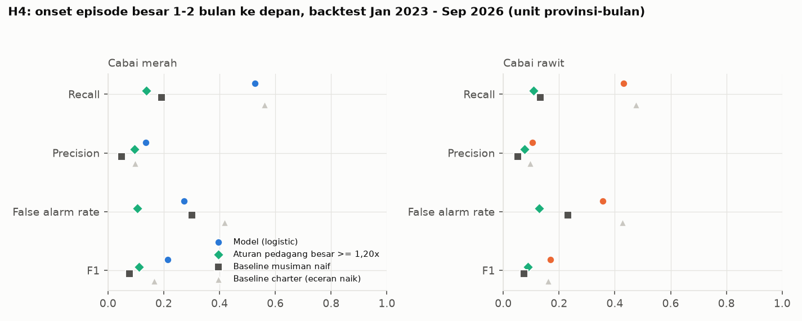
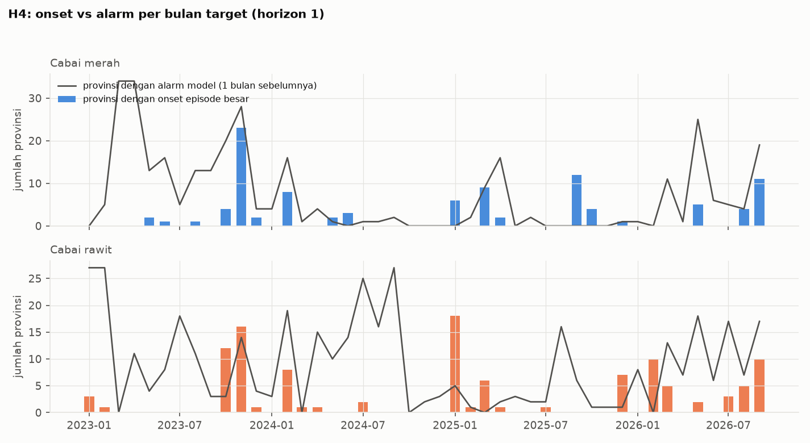

# H4: bisakah lonjakan harga eceran dideteksi 1-2 bulan lebih awal?

Script: `analysis/h4_early_warning.py`. Tabel: `analysis/tables/h4_*.csv`. Rencana: `docs/05_analysis_plan.md` bagian 8 (D-48), sinyal D-55, lag cuaca D-59 dan D-60. Rincian dan aturan keputusan ditulis di D-61 sebelum backtest dijalankan. Aturan final lift dan PR-AUC ditulis di D-63 sebelum angkanya dihitung.

**Keputusan final (D-63): cabai merah sebagian, cabai rawit tidak didukung.**
- Cabai merah:
  - Alarm model 1,8 kali lebih tepat daripada menebak acak (lift 1,81; interval 90% 1,22-2,37).
  - PR-AUC sekitar dua kali baseline charter (0,178 vs 0,087).
  - False alarm lebih rendah pada recall setara, dan US1 terpenuhi.
  - Kenaikan F1 belum pasti.
- Cabai rawit:
  - Lift model hanya 1,18 dengan interval yang mencakup 1 (0,92-1,50). Alarm operasionalnya belum terbukti lebih tepat daripada menebak acak.
  - Skor model memang memeringkat risiko sedikit lebih baik dari baseline (PR-AUC 0,120 vs 0,093), tetapi menurut aturan D-63 ini tidak cukup.
- Precision tetap rendah untuk kedua komoditas: sekitar 1 dari 7-10 alarm yang benar.
- Fitur cuaca membantu model rawit (tanpa cuaca, false alarm-nya lebih buruk dari baseline), tetapi tidak cukup untuk membuat rawit didukung. Untuk merah, cuaca tidak menambah apa-apa.

## 1. Desain singkat

| Elemen | Isi |
| --- | --- |
| Target | Onset episode besar (spike eceran provinsi >= 1,25 x median 12 bulan, bertahan >= 2 bulan) tepat di t+1 (model horizon 1) dan t+2 (model horizon 2). Hanya provinsi yang tidak sedang spike di bulan t |
| Sinyal di bulan t | Perubahan log harga pedagang besar 1 dan 3 bulan; rasio pedagang besar terhadap median 12 bulan; bulan target = Idulfitri / sebelum Idulfitri; ONI t-2 (ONI bulan t baru terbit sekitar dua bulan kemudian). Cuaca: **rawit** = anomali hujan provinsi di lag 2 dan 3 dari bulan target (provinsi non-sentra memakai indeks sentra nasional); **merah** = indeks hujan nasional sentra merah, lag 2-4 dipilih di data latih (D-60). Harga produsen tidak dipakai (D-55) |
| Model | Logistic regression; ambang probabilitas = F1 maksimum di data latih. Pembanding tambahan: aturan sederhana pedagang besar >= 1,20 x median 12 bulan |
| Backtest | Rolling-origin bulanan. Bulan target Jan 2023 - Sep 2026; dilatih ulang di tiap origin hanya dengan label yang sudah terkonfirmasi di bulan itu. 34 provinsi merah, 33 rawit (satu provinsi harga pedagang besar tier `descriptive`) |
| Baseline | Musiman naif (alarm kalau bulan target tahun lalu spike) dan charter (alarm kalau harga eceran naik bulan ini). Baseline lebih kuat = F1 lebih tinggi: **charter, untuk kedua komoditas** |

Periode uji: 182 onset (merah) dan 204 onset (rawit) di unit provinsi-bulan-horizon, yaitu 100 dan 111 episode besar provinsi.

## 2. Hasil utama dan effect size

Unit provinsi-bulan, kedua horizon digabung:

| Sinyal | Merah: recall | precision | false alarm rate | F1 | Rawit: recall | precision | false alarm rate | F1 |
| --- | --- | --- | --- | --- | --- | --- | --- | --- |
| **Model** | 52,7% | 13,5% | 27,2% | **0,215** | 43,1% | 10,5% | 35,8% | **0,168** |
| Baseline charter (eceran naik) | 56,0% | 9,7% | 41,9% | 0,166 | 47,5% | 9,7% | 42,7% | 0,162 |
| Baseline musiman naif | 19,2% | 4,9% | 30,2% | 0,078 | 13,2% | 5,2% | 23,3% | 0,075 |
| Aturan pedagang besar >= 1,20x | 13,7% | 9,4% | 10,6% | 0,112 | 10,8% | 7,5% | 12,8% | 0,089 |

Tiga pembanding utama terhadap baseline charter:

| Ukuran | Cabai merah | Cabai rawit |
| --- | --- | --- |
| Selisih F1 model - charter (interval 90% block bootstrap per bulan) | +0,049 (-0,031 s/d +0,125) | +0,006 (-0,046 s/d +0,052) |
| False alarm rate pada recall yang sama dengan charter | **27,2% vs 41,9%** | **34,8% vs 42,7%** |
| Episode dengan peringatan >= 1 bulan sebelumnya (US1) | **59%** (40% sudah 2 bulan sebelumnya) | **52%** (36% sudah 2 bulan sebelumnya) |
| Episode dengan peringatan >= 1 bulan, baseline charter | 72% | 72% |

Cara membaca:
- Baseline charter menangkap lebih banyak episode karena berbunyi di sekitar 43% provinsi-bulan.
- Model berbunyi di 29% (merah) dan 36% (rawit) provinsi-bulan.
- Pada tingkat tangkapan yang sama, model menghasilkan sekitar sepertiga (merah) dan seperlima (rawit) lebih sedikit false alarm.

Per horizon (`h4_per_horizon.csv`):
- Merah: F1 model lebih tinggi dari charter di kedua horizon (t+1: 0,27 vs 0,19; t+2: 0,17 vs 0,14).
- Rawit t+1: charter lebih baik (0,22 vs 0,19).
- Rawit t+2: model lebih baik (0,15 vs 0,10), karena charter hampir tidak punya informasi untuk dua bulan ke depan.

**Episode nasional (pelengkap).** Porsi provinsi yang mendapat alarm sebelum onset episode besar nasional di periode uji:

| Episode nasional | 2 bulan sebelumnya: model / charter | 1 bulan sebelumnya: model / charter |
| --- | --- | --- |
| Cabai merah, November 2023 | 100% / 30% | 93% / 77% |
| Cabai rawit, November 2023 | 24% / 21% | 67% / 95% |
| Cabai rawit, Januari 2025 | 6% / 9% | 15% / 85% |
| Cabai rawit, September 2026 | 97% / 7% | 68% / 88% |

## 2b. Base rate, lift, dan PR-AUC (D-63)

Base rate = porsi onset di sampel yang diprediksi: provinsi yang tidak sedang spike di bulan origin, periode uji, kedua horizon digabung. Lift = precision / base rate. PR-AUC = average precision. Baseline bersifat biner, sehingga PR-AUC-nya = recall x precision + (1 - recall) x base rate. Interval 90% dari block bootstrap per bulan origin (1.000 ulangan). Tabel: `h4_lift_pr_auc.csv`, `h4_final_decision.csv`.

| Ukuran | Cabai merah | Cabai rawit |
| --- | --- | --- |
| Base rate onset | 7,5% (4,9-10,4) | 8,8% (5,8-11,9) |
| Lift model | **1,81 (1,22-2,37)** | **1,18 (0,92-1,50)** |
| Lift baseline charter | 1,31 (1,07-1,58) | 1,10 (0,80-1,41) |
| Lift baseline musiman naif | 0,66 (0,37-1,02) | 0,59 (0,15-1,17) |
| PR-AUC model | 0,178 (0,094-0,307) | 0,120 (0,085-0,170) |
| PR-AUC baseline charter (baseline terkuat) | 0,087 (0,058-0,123) | 0,093 (0,062-0,129) |
| PR-AUC baseline musiman naif | 0,070 (0,047-0,098) | 0,084 (0,056-0,115) |
| Selisih PR-AUC model - charter | +0,091 (+0,019 s/d +0,201) | +0,027 (+0,002 s/d +0,067) |

- Baseline musiman naif lebih buruk dari menebak acak untuk kedua komoditas (lift di bawah 1). Spike tahun lalu di bulan yang sama tidak memberi informasi tentang onset tahun ini.
- Baseline charter sedikit di atas acak untuk merah (1,31) dan tidak jelas untuk rawit (1,10).
- Model merah memenuhi kedua syarat D-63. Model rawit gagal di syarat lift, meskipun PR-AUC-nya lebih tinggi dari charter dengan interval selisih di atas nol.

## 3. Keputusan terhadap aturan di rencana (D-61) dan aturan final (D-63)

| Kriteria | Cabai merah | Cabai rawit |
| --- | --- | --- |
| (a) F1 > baseline lebih kuat, interval 90% selisih di atas nol | Tidak (F1 lebih tinggi, tetapi interval -0,031 s/d +0,125) | Tidak (+0,006; interval -0,046 s/d +0,052) |
| (b) False alarm rate lebih rendah pada recall setara | Ya (27% vs 42%) | Ya (35% vs 43%) |
| (c) US1: >= 50% episode terdeteksi dengan lead time >= 1 bulan | Ya (59%) | Ya (52%) |
| Keputusan menurut D-61 | Sebagian | Sebagian |
| D-63: lift model jelas > 1 (batas bawah interval 90% > 1) | Ya (1,22) | **Tidak (0,92)** |
| D-63: PR-AUC model > baseline terkuat (charter) | Ya (0,178 vs 0,087) | Ya (0,120 vs 0,093) |
| **Keputusan final (D-63)** | **Sebagian** | **Tidak didukung** |

## 4. Sensitivity check

| Spesifikasi | Merah: F1 model / charter | Merah: FAR pada recall setara (model / charter) | Merah: episode terdeteksi | Rawit: F1 model / charter | Rawit: FAR pada recall setara | Rawit: episode terdeteksi | Keputusan (merah / rawit) |
| --- | --- | --- | --- | --- | --- | --- | --- |
| Utama | 0,215 / 0,166 | 27% / 42% | 59% | 0,168 / 0,162 | 35% / 43% | 52% | sebagian / sebagian |
| Tanpa fitur cuaca | 0,218 / 0,166 | 30% / 42% | 59% | 0,165 / 0,162 | **51% / 43%** | 63% | sebagian / **dibantah** |
| Tanpa bulan imputasi pada fitur (D-44) | 0,220 / 0,166 | 27% / 42% | 61% | 0,162 / 0,162 | 36% / 43% | 48% | sebagian / sebagian |
| Ambang spike 1,15 | 0,258 / 0,229 | 33% / 38% | 74% | 0,232 / 0,216 | 37% / 39% | 54% | sebagian / sebagian |
| Ambang spike 1,35 | 0,194 / 0,114 | 15% / 45% | 65% | 0,184 / 0,119 | 32% / 45% | 51% | sebagian / sebagian |
| Target onset spike apa pun (>= 1 bulan) | 0,255 / 0,229 | 32% / 41% | 77% | 0,250 / 0,219 | 37% / 43% | 62% | sebagian / sebagian |
| Hanya provinsi bertitik sentra | 0,248 / 0,166 | 24% / 42% | 50% | 0,212 / 0,174 | 36% / 42% | 56% | sebagian / sebagian |
| Hanya provinsi bertitik sentra, tanpa cuaca | 0,244 / 0,166 | 24% / 42% | 60% | 0,192 / 0,174 | 44% / 42% | 59% | sebagian / dibantah |

Catatan:
- Cuaca.
  - Untuk rawit, fitur cuaca membuat model mengalahkan baseline pada false alarm rate (35% dengan cuaca vs 51% tanpa cuaca, pada recall yang sama). Pola yang sama muncul di subset provinsi sentra (36% vs 44%).
  - Harganya: deteksi episode pada ambang operasional turun (52% vs 63%), karena ambang yang dipilih di data latih jadi lebih ketat.
  - Untuk merah, indeks hujan nasional tidak menambah apa-apa (F1 0,215 vs 0,218). Lag yang terpilih di setiap origin selalu lag 2 (`h4_merah_lag_choice.csv`), sesuai lampiran H1.
- D-44: hanya 4 bulan imputasi harga pedagang besar di seluruh core, jadi hasilnya praktis sama.
- Ambang spike: keunggulan model paling jelas di ambang 1,35. Pada lonjakan yang lebih tajam, false alarm rate merah 15% vs 45%.

## 5. Temuan yang terbukti

1. Sinyal hulu (momentum dan rasio harga pedagang besar, kalender Idulfitri, ONI, dan untuk rawit anomali hujan) **menurunkan false alarm** dibanding baseline "harga eceran naik bulan ini" pada tingkat tangkapan yang sama: dari 42% menjadi 27% (merah) dan dari 43% menjadi 35% (rawit).
2. US1 terpenuhi: 59% episode merah dan 52% episode rawit mendapat peringatan minimal 1 bulan sebelum onset; sekitar 36-40% sudah 2 bulan sebelumnya.
3. Kenaikan F1 belum pasti: interval 90% selisih F1 terhadap baseline charter mencakup nol untuk kedua komoditas.
4. Precision rendah untuk semua sinyal: paling tinggi 13,5% (model merah). Onset episode besar hanya sekitar 7-9% provinsi-bulan, sehingga sebagian besar alarm tidak diikuti onset dalam 1-2 bulan.
5. Dibanding menebak acak (D-63): alarm model merah 1,8 kali lebih tepat dan jelas di atas acak. Alarm model rawit 1,2 kali, dengan interval yang mencakup 1, sehingga belum terbukti lebih baik dari acak. Baseline musiman naif lebih buruk dari acak untuk kedua komoditas.
6. Cuaca berguna untuk rawit, tidak untuk merah. Tanpa anomali hujan, model rawit kalah dari baseline pada false alarm rate.
7. Aturan sederhana "pedagang besar >= 1,20 x median 12 bulan" tidak layak sendirian: recall hanya 11-14%.

## 6. Dugaan yang perlu verifikasi

1. Banyak false alarm yang sebetulnya "hampir spike". Lonjakan cabai bersifat nasional (H3), dan model cenderung berbunyi serentak di banyak provinsi. Contohnya awal 2023 untuk merah: alarm di sekitar 34 provinsi tanpa onset. Sebagian alarm palsu mungkin jatuh di bulan dengan kenaikan harga yang tidak mencapai 1,25x atau tidak bertahan 2 bulan. Verifikasi: hitung rasio harga di bulan target untuk alarm palsu.
2. Onset rawit Januari 2025 terlewat (hanya 6-15% provinsi mendapat alarm), sedangkan baseline charter menangkapnya 1 bulan sebelumnya. Dugaan: kenaikan dimulai dari eceran sendiri atau dari guncangan yang tidak terlihat di harga pedagang besar dan hujan sentra bulan-bulan sebelumnya. Verifikasi: telusuri harga mingguan Desember 2024 - Januari 2025.
3. Peringatan di tingkat nasional mungkin lebih berguna daripada per provinsi. Untuk episode merah November 2023, model memberi alarm di 100% provinsi dua bulan sebelumnya. Verifikasi: model khusus untuk spike nasional, dengan jumlah episode yang memang sedikit.
4. Ambang alarm rawit mungkin terlalu longgar. PR-AUC rawit lebih tinggi dari charter (interval selisih di atas nol), artinya skor memeringkat risiko sedikit lebih baik, tetapi ambang F1 di data latih menghasilkan alarm di 36% provinsi-bulan. Ambang yang lebih ketat mungkin menaikkan lift. Memilih ambang itu dari data uji tidak sah. Verifikasi: aturan ambang lain yang ditetapkan sebelumnya (misalnya porsi alarm maksimal) di backtest baru.
5. Kombinasi model + baseline charter (misalnya alarm kalau keduanya berbunyi) mungkin menaikkan precision. Ini tidak diuji karena tidak ada di rencana.

## 7. Keterbatasan

- Episode besar di periode uji hanya sekitar 100-111 per komoditas di tingkat provinsi, dan saling berkorelasi karena lonjakan serentak. Interval bootstrap per bulan sudah memperhitungkan korelasi ini, sehingga lebar.
- Cuaca dari reanalysis (sekitar 25 km), bukan stasiun. Data Open-Meteo sudah tersedia beberapa hari setelah akhir bulan, sehingga sinyal bulan t bisa dipakai di akhir bulan t.
- Harga produsen sengaja tidak dipakai (D-55). Label baru terkonfirmasi satu bulan setelah onset, dan backtest sudah memperhitungkan ini.
- Ambang spike dan definisi episode besar adalah pilihan analisis (D-48). Sensitivity 1,15/1,35 dan "spike apa pun" memberi kesimpulan yang sama.

## 8. So what

Untuk **cabai merah**, sistem peringatan dini berbasis harga pedagang besar, kalender Lebaran, dan ENSO layak dipakai sebagai daftar pantau. Model ini memberi tahu sekitar 6 dari 10 lonjakan besar setidaknya sebulan sebelumnya, dan alarmnya hampir dua kali lebih tepat daripada menebak acak. Meski begitu, dari sepuluh alarm hanya satu sampai dua yang benar, jadi alarm cocok untuk menentukan provinsi mana yang perlu dicek lebih teliti, bukan pemicu otomatis operasi pasar.

Untuk **cabai rawit**, model yang sama belum layak dipakai. Alarmnya belum terbukti lebih tepat daripada menebak acak, walaupun data hujan di sentra memperbaikinya. Sebelum ada model rawit yang lebih baik, pemantauan rawit sebaiknya tetap bertumpu pada pergerakan harga eceran dan pedagang besar yang dibaca langsung oleh analis.
