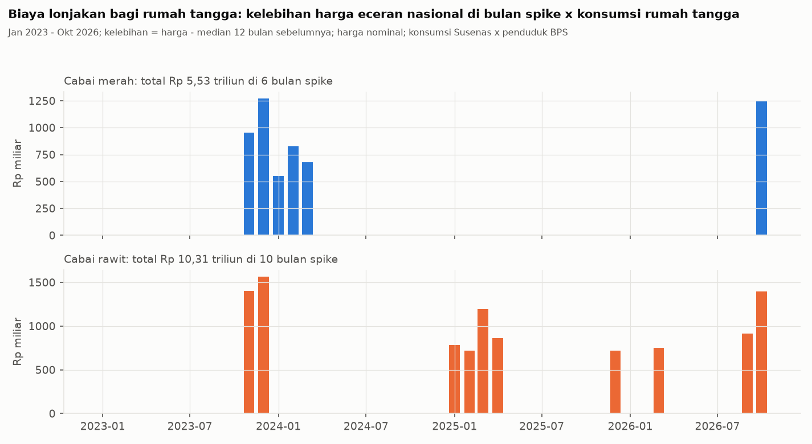
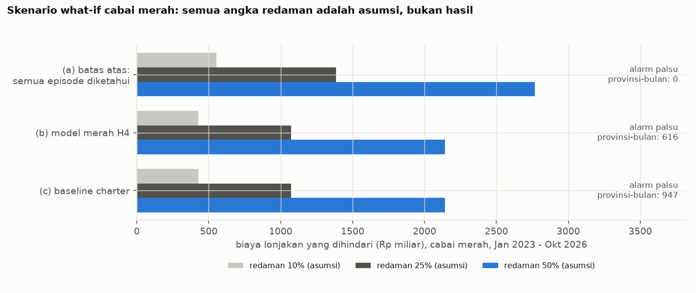
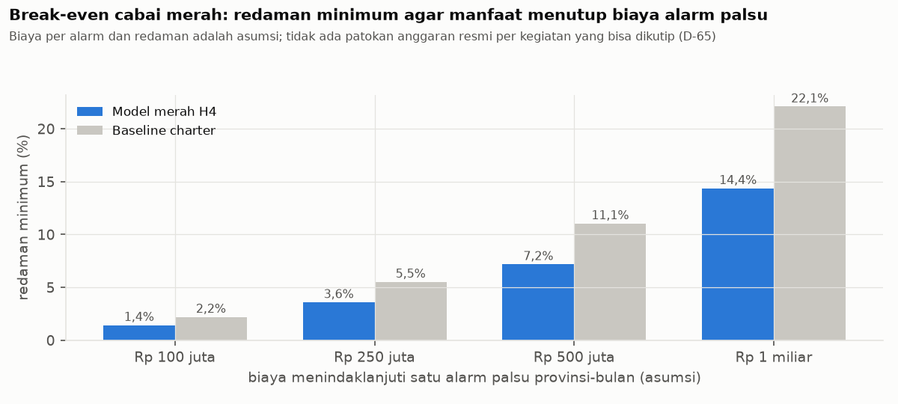

# Skenario what-if: berapa biaya lonjakan, dan berapa yang bisa dihindari kalau diketahui lebih awal?

Script: `analysis/scenario_whatif.py`. Tabel: `analysis/tables/scenario_*.csv`. Desain dan aturan ditulis di D-64 sebelum perhitungan.

**Penting:** semua angka redaman (10%, 25%, 50%) dan biaya menindaklanjuti alarm adalah **asumsi**. Proyek ini tidak punya data intervensi, jadi efektivitas operasi pasar atau intervensi lain tidak bisa diestimasi. Yang diukur dari data hanya: (1) biaya lonjakan bagi rumah tangga, (2) episode mana yang terdeteksi lebih awal di backtest H4, dan (3) jumlah alarm palsu.

## 1. Data dan cara hitung

**Biaya lonjakan** per bulan spike nasional (harga eceran nasional >= 1,25 x median 12 bulan sebelumnya), Jan 2023 - Okt 2026:

biaya = (harga eceran nasional - median 12 bulan sebelumnya) x konsumsi rumah tangga nasional bulan itu.

Bulan tanpa spike dihitung nol.

**Konsumsi rumah tangga nasional per bulan** = konsumsi per kapita x jumlah penduduk / 12. Angka diekstrak oleh script langsung dari PDF Buletin Konsumsi Pangan di `data/raw/buletin/pdf/`:

| Tahun | Cabai merah (kg/kapita/tahun) | Cabai rawit (kg/kapita/tahun) | Sumber konsumsi | Penduduk (ribu jiwa) | Sumber penduduk |
| --- | --- | --- | --- | --- | --- |
| 2023 | 2,023 | 2,192 | Susenas Maret 2023, Tabel 7.1 Buletin Vol. 17 No. 1 2026, hlm 58 | 278.835 | Proyeksi interim SP2020 BPS; Buletin Vol. 14 No. 1 2023, hlm 62 |
| 2024 | 1,790 | 2,125 | Susenas Maret 2024, sumber sama | 281.604 | Proyeksi SP2020 BPS; Buletin Vol. 15 No. 1 2024, hlm 54 |
| 2025 | 1,875 | 1,992 | Susenas Maret 2025, sumber sama | 284.439 | Proyeksi SP2020 BPS; Buletin Vol. 16 No. 1 2025, hlm 61 |
| 2026 | **1,875 (flag: Susenas 2025)** | **1,992 (flag: Susenas 2025)** | Susenas 2026 belum ada; angka prediksi Pusdatin tidak dipakai | 287.198 | Proyeksi SP2020 BPS; Buletin Vol. 17 No. 1 2026, hlm 64 |

- Susenas "cabai merah" dipasangkan dengan `cabai_merah` PIHPS (rata-rata merah besar dan keriting). Cabai hijau tidak dihitung.
- Harga nominal, tanpa penyesuaian inflasi.

## 2. Biaya lonjakan 2023 - Okt 2026

| Komoditas | Bulan spike nasional | Episode | Kelebihan harga rata-rata di bulan spike | Biaya lonjakan bagi rumah tangga |
| --- | --- | --- | --- | --- |
| Cabai merah | 6 | 2 | Rp 20.702/kg | **Rp 5,53 triliun** |
| Cabai rawit | 10 | 5 | Rp 21.309/kg | **Rp 10,31 triliun** |

Per episode (`scenario_episodes.csv`):

| Komoditas | Episode | Bulan | Rasio puncak | Biaya | Bisa dinilai di backtest H4 |
| --- | --- | --- | --- | --- | --- |
| Merah | Nov 2023 - Mar 2024 | 5 | 1,61 | Rp 4,28 triliun | Ya |
| Merah | Okt 2026 (masih berjalan) | 1 | 1,52 | Rp 1,25 triliun | Tidak (mulai setelah Sep 2026; flag, dihitung tidak terdeteksi) |
| Rawit | Nov - Des 2023 | 2 | 1,62 | Rp 2,96 triliun | Ya |
| Rawit | Jan - Apr 2025 | 4 | 1,47 | Rp 3,56 triliun | Ya |
| Rawit | Des 2025 | 1 | 1,29 | Rp 0,72 triliun | Ya |
| Rawit | Mar 2026 | 1 | 1,28 | Rp 0,75 triliun | Ya |
| Rawit | Sep - Okt 2026 (masih berjalan) | 2 | 1,47 | Rp 2,31 triliun | Ya |

## 3. Skenario cabai merah (redaman = asumsi)

Episode nasional dianggap diketahui lebih awal kalau di backtest H4 alarm berbunyi di >= 50% provinsi 1 atau 2 bulan sebelum bulan pertamanya (D-64). Episode Nov 2023 terdeteksi oleh model maupun baseline charter: 93% dan 77% provinsi beralarm sebulan sebelumnya.

| Skenario | Biaya episode yang diketahui lebih awal | Dihindari jika redaman 10% (asumsi) | 25% (asumsi) | 50% (asumsi) | Alarm palsu provinsi-bulan (per bulan) | Bulan alarm nasional (yang palsu) |
| --- | --- | --- | --- | --- | --- | --- |
| (a) Batas atas: semua episode diketahui lebih awal | Rp 5,53 T (100%) | Rp 0,55 T | Rp 1,38 T | Rp 2,77 T | 0 | - |
| (b) Model merah H4 | Rp 4,28 T (77%) | Rp 0,43 T | Rp 1,07 T | Rp 2,14 T | 616 (13,4) | 21 (18) |
| (c) Baseline charter | Rp 4,28 T (77%) | Rp 0,43 T | Rp 1,07 T | Rp 2,14 T | 947 (20,6) | 20 (18) |

**Break-even (D-65).** Biaya menindaklanjuti satu alarm palsu (pengecekan lapangan, koordinasi, atau intervensi yang ternyata tidak perlu) tidak diketahui, jadi disajikan sebagai rentang.

Tidak ada patokan resmi yang bisa dikutip:
- Rencana Aksi Deputi Bidang Ketersediaan dan Stabilisasi Pangan Bapanas 2024 dan 2025 memuat jumlah kegiatan Gerakan Pangan Murah (misalnya 1.626 kegiatan yang didanai APBN Bapanas), tetapi tidak memuat anggaran per kegiatan.
- Angka anggaran lain yang ditemukan hanya dari berita, bukan dokumen resmi Bapanas atau pemda, dan tidak khusus cabai. Angka itu tidak dipakai.

Redaman minimum agar biaya lonjakan yang dihindari sama dengan biaya semua alarm palsu (`scenario_breakeven.csv`):

| Biaya per alarm palsu provinsi-bulan (asumsi) | Model merah (616 alarm palsu) | Baseline charter (947 alarm palsu) |
| --- | --- | --- |
| Rp 100 juta | 1,4% | 2,2% |
| Rp 250 juta | 3,6% | 5,5% |
| Rp 500 juta | 7,2% | 11,1% |
| Rp 1 miliar | 14,4% | 22,1% |

Dari arah sebaliknya: biaya maksimum per alarm palsu agar manfaat tetap positif, untuk tiap redaman yang diasumsikan:

| Ukuran | Model merah | Baseline charter |
| --- | --- | --- |
| Biaya maksimum per alarm palsu agar manfaat tetap positif, redaman 10% (asumsi) | Rp 0,70 miliar | Rp 0,45 miliar |
| Sama, redaman 25% (asumsi) | Rp 1,74 miliar | Rp 1,13 miliar |
| Sama, redaman 50% (asumsi) | Rp 3,48 miliar | Rp 2,26 miliar |

Cara membaca: di rentang biaya Rp 100 juta sampai Rp 1 miliar per alarm palsu, peringatan dini model merah sepadan selama tindak lanjutnya meredam minimal sekitar 1,4% sampai 14,4% kelebihan harga di episode yang terdeteksi. Baseline charter butuh redaman sekitar 1,5 kali lebih besar karena alarm palsunya lebih banyak. Angka-angka ini hanya ilustrasi aritmetika dari asumsi, bukan perkiraan manfaat.

## 4. Cabai rawit

Biaya lonjakan rawit (Rp 10,31 triliun) hampir dua kali merah. Penyebabnya lebih banyak bulan spike dan konsumsi per kapita sedikit lebih tinggi. Skenario (b) tidak dihitung untuk rawit, karena **model peringatan dini rawit belum lolos uji** (H4 final, D-63: lift 1,18, interval 0,92-1,50, belum jelas di atas menebak acak).

Yang dibutuhkan agar model rawit bisa diuji ulang:
- Harga produsen yang lebih sering diperbarui. Di PIHPS, harga produsen hanya berubah di sekitar 22% minggu (H2, D-56), sehingga sinyal dari tingkat petani tidak bisa dipakai (D-55). Padahal H1 menunjukkan harga produsen rawit merespons hujan di sentra dengan lag 3 bulan.
- Aturan ambang alarm yang lebih ketat, ditetapkan sebelum backtest baru (future work, D-64). PR-AUC rawit lebih tinggi dari baseline charter, jadi skornya memeringkat risiko sedikit lebih baik.
- Mungkin juga model khusus spike nasional, karena lonjakan rawit bersifat serentak (H3).

## 5. Temuan yang terbukti

1. Biaya lonjakan bagi rumah tangga Jan 2023 - Okt 2026 (konsumsi rumah tangga saja, harga nominal): sekitar Rp 5,5 triliun untuk cabai merah dan Rp 10,3 triliun untuk cabai rawit. Di bulan spike, rumah tangga membayar rata-rata sekitar Rp 21.000/kg di atas harga normal 12 bulan sebelumnya.
2. Satu episode merah besar mendominasi: Nov 2023 - Mar 2024 menyumbang 77% biaya lonjakan merah (Rp 4,28 triliun).
3. Di backtest H4, episode merah Nov 2023 terdeteksi lebih awal oleh model (93% provinsi beralarm sebulan sebelumnya, 100% dua bulan sebelumnya) dan oleh baseline charter (77% sebulan sebelumnya). Jadi pada episode yang bisa dinilai, model dan baseline sama-sama "menangkap" episode itu. Bedanya ada di alarm palsu: 616 vs 947 provinsi-bulan, sepertiga lebih sedikit untuk model.
4. Di tingkat nasional, alarm palsu dominan untuk kedua sinyal: dari sekitar 20 bulan dengan alarm di >= 50% provinsi, 18 tidak diikuti onset spike nasional dalam 1-2 bulan.

## 6. Dugaan yang perlu verifikasi

1. Besar manfaat bergantung sepenuhnya pada redaman yang diasumsikan. Tanpa data intervensi (kapan, di mana, berapa volume operasi pasar), redaman tidak bisa diestimasi. Verifikasi: data operasi pasar/SPHP Bapanas per provinsi-bulan, dibandingkan dengan harga sebelum dan sesudah.
2. Hasil skenario (b) vs (c) bertumpu pada satu episode merah yang bisa dinilai. Dengan satu episode, tidak bisa dikatakan model lebih sering menangkap episode daripada baseline. Yang bisa dikatakan hanya bahwa model mencapai hal yang sama dengan alarm palsu lebih sedikit.
3. Biaya lonjakan kemungkinan understate. Hanya konsumsi rumah tangga yang dihitung. Neraca Bapanas di Buletin menambahkan horeka/PMM (25% dari konsumsi rumah tangga) dan industri (20%), sehingga total kebutuhan sekitar 1,45 kali konsumsi rumah tangga (asumsi Ditjen Hortikultura, bukan hasil proyek ini). Median 12 bulan sebagai harga normal juga ikut naik selama episode panjang, sehingga kelebihan harga di akhir episode ter-understate.
4. Ada juga arah overstate. Saat harga tinggi, rumah tangga mungkin membeli lebih sedikit, sedangkan konsumsi di sini dianggap tetap sepanjang tahun.

## 7. Keterbatasan

- Konsumsi rumah tangga saja, jadi biaya lonjakan understate. Konsumsi per kapita Susenas tahunan dibagi rata ke 12 bulan, tanpa pola musiman.
- Harga nominal, tanpa penyesuaian inflasi.
- Redaman dan biaya per alarm palsu adalah asumsi, bukan hasil. Tidak ada angka efektivitas intervensi yang diklaim, dan tidak ada patokan anggaran resmi per kegiatan yang bisa dikutip (D-65).
- 2026 memakai konsumsi per kapita Susenas 2025 (flag), karena Susenas 2026 belum ada.
- Episode merah Okt 2026 masih berjalan, dan November 2026 parsial tidak dihitung, sehingga biayanya akan bertambah.
- Biaya lonjakan adalah tambahan pengeluaran rumah tangga. Sebagian menjadi pendapatan pelaku rantai pasok, jadi ini bukan kerugian ekonomi bersih.

## 8. So what

Lonjakan harga cabai bukan masalah kecil: dalam hampir empat tahun, rumah tangga Indonesia membayar sekitar Rp 16 triliun lebih mahal untuk cabai merah dan rawit di bulan-bulan lonjakan. Itu baru dari belanja rumah tangga, belum termasuk warung, restoran, dan industri. Sebagian besar biaya itu terkumpul di beberapa episode besar, terutama akhir 2023 untuk kedua jenis cabai dan awal 2025 untuk rawit.

Untuk cabai merah, peringatan dini sudah bisa menangkap episode besar seperti akhir 2023 satu sampai dua bulan sebelumnya. Kalau tindak lanjutnya berbiaya Rp 100 juta sampai Rp 1 miliar per provinsi per bulan, intervensi perlu meredam sekitar 1-14% kelebihan harga untuk sepadan dengan alarm palsunya. Tetapi seberapa besar redaman yang benar-benar bisa dicapai belum diketahui. Itu pertanyaan berikutnya, dan butuh data intervensi, bukan data harga saja. Untuk cabai rawit, biaya lonjakannya lebih besar, tetapi alat peringatan dininya belum siap. Perbaikan data harga produsen adalah prasyarat.
