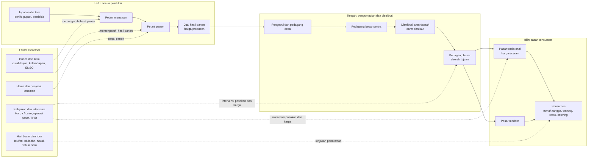
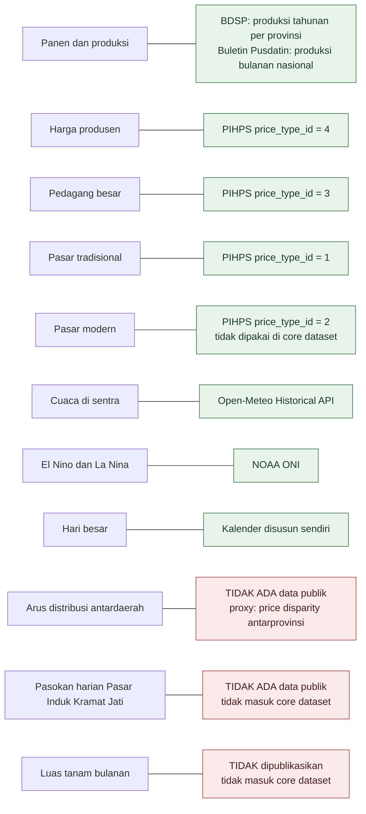

# AS-IS Process Map: Rantai Pasok Cabai

Dokumen ini menggambarkan bagaimana cabai bergerak dari petani sampai konsumen **saat ini**, beserta faktor yang memengaruhi volume dan harga di tiap tahap. Tujuannya satu: menunjukkan di titik mana data publik bisa mengamati rantai ini, dan di titik mana tidak.

> **Catatan sumber.** Gambaran ini disusun dari secondary research (pernyataan pejabat, pedagang, petani, dan penelitian yang dikutip media; lihat daftar sumber di Project Charter), bukan dari wawancara atau survei lapangan. Detail tiap tahap (misalnya peran pengepul) perlu dibaca sebagai generalisasi, dan bisa berbeda antar sentra.

## 1. Peta proses

## 2. Titik pengamatan data

Peta berikut menandai tahap mana yang punya data publik, dan sumbernya.

## 3. Tahap, masalah yang diketahui, dan kaitannya dengan hipotesis

| Tahap | Apa yang terjadi | Titik rawan (dari secondary research) | Hipotesis terkait | Data yang mengamati |
| --- | --- | --- | --- | --- |
| Input dan tanam | Petani memutuskan kapan dan seberapa luas menanam | Keputusan tanam mengikuti harga musim sebelumnya, sehingga ramai-ramai menanam lalu panen berlimpah (cobweb cycle) | H5 | Produksi bulanan (hasil disagregasi); luas tanam tidak tersedia |
| Panen | Hasil panen ditentukan cuaca dan hama | Curah hujan ekstrem dan serangan penyakit menurunkan volume | H1 | Curah hujan Open-Meteo, ONI, produksi |
| Harga produsen | Petani menjual ke pengepul | Harga anjlok saat panen ramai, naik cepat saat gagal panen | H1, H2 | PIHPS tipe 4 |
| Pengumpulan | Pengepul dan pedagang besar sentra mengumpulkan volume | Tidak ada data publik di level ini selain harga pedagang besar | H2 | PIHPS tipe 3 |
| Distribusi antardaerah | Cabai dikirim dari sentra ke daerah konsumsi dan daerah defisit | Daerah jauh dari sentra menanggung biaya dan waktu angkut; nasional surplus tapi daerah tertentu defisit | H3 | Tidak ada data arus; proxy price disparity antarprovinsi |
| Harga eceran | Pedagang pasar menjual ke konsumen | Kenaikan diteruskan cepat, penurunan lambat (asymmetric price transmission) | H2 | PIHPS tipe 1 |
| Konsumsi | Rumah tangga dan usaha makanan membeli | Permintaan naik di sekitar hari besar | H6 | Kalender hari besar |
| Intervensi | Pemerintah dan TPID menekan harga | Data intervensi tidak lengkap, sehingga policy evaluation tidak masuk scope | di luar scope | Tidak tersedia |

## 4. Batasan peta ini

- Rantai digambar linear supaya mudah dibaca. Di lapangan satu pedagang bisa melewati beberapa tahap, dan sebagian petani menjual langsung ke pasar.
- Tahap "distribusi antardaerah" adalah kotak hitam. H3 hanya bisa diuji lewat proxy (price disparity), jadi kesimpulannya akan berbentuk asosiasi, bukan bukti mekanisme.
- Peta ini akan diperbarui kalau hasil analisis menunjukkan tahap lain yang ikut berperan. Perubahan dicatat di `decision_log.md`.
