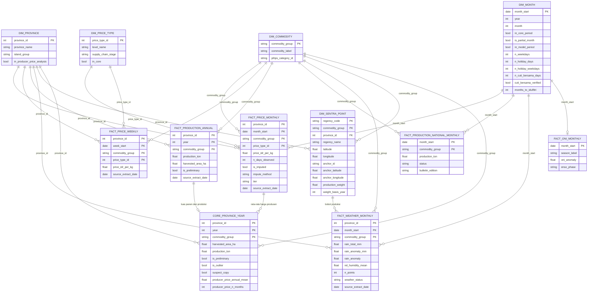

# ERD: Core Dataset

Core dataset disusun sebagai star schema: tabel fakta per jenis variabel (harga, produksi, cuaca, ENSO), dikelilingi tabel dimensi. Grain utama **provinsi × bulan × grup komoditas**. Tabel mingguan terpisah karena hanya dipakai untuk lead-lag analysis.

Dari tabel-tabel ini, pipeline membangun satu tabel lebar `core_province_month` (lihat bagian 3) yang menjadi input analisis.

## 1. Diagram

## 2. Keputusan desain yang perlu diketahui pembaca

- **Grup komoditas, bukan varian.** Core memakai dua grup: `cabai_merah` (PIHPS `cat_7`, rata-rata besar dan keriting) dan `cabai_rawit` (`cat_8`). Produksi `cabai_merah` = cabe besar BDSP saja, konsisten 2018-2025 dan cocok dengan angka resmi; cabe keriting dikonversi dari kuintal ke ton dan disimpan terpisah (`commodity_group = cabai_keriting`, referensi, tidak masuk core). Varian (merah besar, merah keriting, rawit merah, rawit hijau) tidak masuk core, tetapi tetap ditarik ke `data/raw` untuk analisis deskriptif per jenis cabai (US3); lihat D-10 dan D-28 di decision log.
- **34 provinsi.** Sumber yang sudah memakai 38 provinsi dipetakan ke provinsi induk (Papua Selatan, Papua Tengah, Papua Pegunungan ke Papua; Papua Barat Daya ke Papua Barat). Lihat D-17.
- **Tipe harga di baris, bukan di kolom**, pada tabel fakta. Dengan begitu `is_imputed` dan `impute_method` melekat pada setiap nilai harga, sesuai aturan wajib di data quality rules. Tipe harga yang masuk core: 1 (eceran), 3 (pedagang besar), 4 (produsen). Tipe 2 (pasar modern) tidak dipakai oleh hipotesis mana pun.
- **Cuaca dikunci per komoditas.** Bobot production-weighted average berbeda antara cabai merah dan cabai rawit karena sentranya berbeda, jadi `FACT_WEATHER_MONTHLY` punya `commodity_group` di key.
- **Titik sentra dipilih nasional, bukan per provinsi (D-24).** Kabupaten diambil dari produksi nasional teratas sampai kumulatif sekitar 80% per grup komoditas; kabupaten yang berjarak kurang dari 10 km berbagi satu lokasi cuaca (`anchor_id`). Sebagian provinsi tidak punya titik sentra.
- **Cuaca not applicable (D-25).** Untuk provinsi × komoditas tanpa titik sentra, baris cuaca tetap ada dengan nilai `NULL` dan `weather_status = 'not_applicable'`. Ini berbeda dari missing: provinsi itu memang bukan sentra, jadi cuaca tidak dipakai dalam uji H1 dan H4. Provinsi bersentra memakai `weather_status = 'observed'`.
- **Produksi di core memakai angka tahunan (D-42).** Disagregasi bulanan (Chow-Lin, lalu Denton) dibatalkan karena hold-out tidak menunjukkan keunggulan atas flat. `core_province_month.production_annual_ton` = angka tahunan BDSP yang sama untuk 12 bulan dalam tahunnya.
- **Produksi nasional bulanan boleh kosong.** Bulan yang hanya punya proyeksi dibiarkan `production_ton = NULL` dan `status = 'missing'`. Bulan realisasi (Januari-Maret 2022-2026) hanya untuk deskriptif.
- **Uji H5 di grain provinsi × tahun (D-27).** `CORE_PROVINCE_YEAR` memuat luas panen dan produksi tahunan BDSP serta rata-rata harga produsen tahunan, untuk menguji luas panen t terhadap harga produsen t-1.
- **BDSP 2025 preliminary (D-29).** Angka 2025 belum bisa diverifikasi ke rilis BPS, jadi `is_preliminary = TRUE` dan masuk daftar sensitivity check bersama 2026.
- **Produksi 2026.** Angka tahunan 2026 belum terbit, jadi `production_annual_ton` kosong untuk 2026. Tidak di-extrapolate.
- **Periode.** `DIM_MONTH` memuat Januari 2018 sampai November 2026. `in_core_period` bernilai `TRUE` mulai Januari 2019; baris 2018 hanya untuk lagged variables.
- **Bulan parsial dan periode model.** Data diambil 19 November 2026, jadi November 2026 belum penuh (`is_partial_month = TRUE`). Model dan uji hipotesis hanya memakai bulan dengan `in_model_period = TRUE` (Januari 2019 sampai Oktober 2026); November 2026 hanya untuk deskriptif (D-16).
- **Cuaca.** `rain_anomaly` dihitung terhadap normal bulan kalender periode 1991-2020 (D-19), dalam satuan simpangan baku; `rain_anomaly_mm` menyimpan selisih dalam mm. November 2026 berstatus `partial_month` dengan nilai `NULL` (D-57).
- **ONI.** Tabel ONI nasional (sama untuk semua provinsi), tanpa key provinsi. Karena ONI baru tersedia sampai ASO 2026 (dipetakan ke September), Oktober dan November 2026 kosong dan tidak di-impute.

## 3. Tabel akhir: `core_province_month`

Pipeline mengubah tabel fakta menjadi satu tabel lebar di `data/final/`, satu baris per **provinsi × bulan × grup komoditas**:

| Kelompok kolom | Isi |
| --- | --- |
| Key | `province_id`, `month_start`, `commodity_group` |
| Harga | `price_retail`, `price_wholesale`, `price_producer` |
| Produksi | `production_annual_ton`, `production_annual_preliminary` |
| Cuaca | `rain_total_mm`, `rain_anomaly_mm`, `rain_anomaly`, `rel_humidity_mean`, `weather_status`, `weather_n_points` |
| ENSO | `oni_anomaly`, `enso_phase` |
| Kalender | `n_weekdays`, `n_holiday_days`, `n_holiday_weekdays`, `n_cuti_bersama_days`, `cuti_bersama_verified`, `months_to_idulfitri` |
| Flag | untuk tiap harga: `<variabel>_is_imputed`, `<variabel>_impute_method`, `<variabel>_tier`, `<variabel>_n_days`; periode: `in_core_period`, `in_model_period`, `is_partial_month`, `in_producer_price_analysis` |

Aturan: tidak boleh ada nilai kosong tanpa penjelasan. Sel kosong hanya sah kalau sebabnya tercatat (di luar periode, variabel tanpa observed data, NTT harga produsen, produksi 2026, bulan parsial).

Tabel mingguan `FACT_PRICE_WEEKLY` tidak ikut digabung. Ia dipakai langsung oleh analisis lead-lag.

## 4. Tabel akhir: `core_province_year`

Satu baris per **provinsi × tahun × grup komoditas**, untuk uji H5 (cobweb): luas panen t terhadap harga produsen t-1 (D-27).

| Kelompok kolom | Isi |
| --- | --- |
| Key | `province_id`, `year`, `commodity_group` |
| Produksi | `harvested_area_ha`, `production_ton`, `is_preliminary` (TRUE untuk 2025) |
| Harga | `producer_price_annual_mean`, `producer_price_n_months` (jumlah bulan terisi, untuk menilai kualitas rata-rata) |

Tahun 2026 tidak ada karena angka tahunan BDSP belum terbit.
