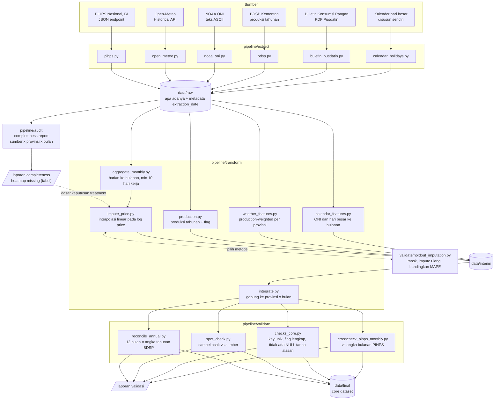

# Data Flow Diagram: Pipeline

Pipeline berjalan satu arah: **extract → audit → transform → validate → final**. Satu command menjalankan semuanya:

```
python -m pipeline.run
```

Command yang sama bisa dijalankan ulang untuk menambah bulan baru tanpa proses manual. Opsi untuk menjalankan satu tahap saja (misalnya `--stage extract`) akan ditambahkan saat `pipeline/run.py` dibuat di fase build.

## 1. Diagram



## 2. Modul, input, output

| Modul | Input | Output | Aturan utama |
| --- | --- | --- | --- |
| `extract/pihps.py` | `GetGridDataKomoditas` per kuartal, harian, tipe harga 1/3/4, `cat_7` dan `cat_8` plus empat varian (merah besar, merah keriting, rawit merah, rawit hijau), semua provinsi; tipe laporan mingguan untuk data lead-lag; tipe laporan bulanan (`tipe_laporan=3`) untuk cross-check | JSON/CSV di `data/raw/pihps/` | Request berurutan dengan jeda, tidak paralel; satu kuartal per request; retry saat timeout. Varian hanya untuk analisis deskriptif, tidak masuk core |
| `extract/open_meteo.py` | Koordinat titik sentra, 1991-01-01 sampai tanggal extraction | Harian per titik di `data/raw/open_meteo/` | Titik sentra: kabupaten dengan produksi nasional teratas sampai kumulatif sekitar 80% per komoditas, titik berjarak < 10 km digabung (D-24). Mulai 1991 karena baseline normal memakai 1991-2020 (D-19). Satu lokasi 1991-2026 sekitar 187 call; batas 10.000 call/hari, jadi extract bisa makan beberapa hari dan resumable |
| `extract/noaa_oni.py` | `oni.ascii.txt` | `data/raw/noaa_oni/` | Simpan apa adanya |
| `extract/bdsp.py` | Form/endpoint BDSP: produksi dan luas panen, level provinsi dan kabupaten | `data/raw/bdsp/` | Angka desimal berkoma disimpan mentah, parsing di transform |
| `extract/buletin_pusdatin.py` | Semua edisi Semester I dan II yang bisa ditemukan | PDF asli plus tabel hasil ekstraksi di `data/raw/buletin/` | `pdfplumber`/`camelot`; OCR kalau tabel berupa gambar; catatan kaki realisasi/proyeksi ikut disimpan |
| `extract/calendar_holidays.py` | Daftar hari besar 2018-2026 yang ditulis di kode | `data/raw/calendar/` | Disusun manual, dicatat sumber tanggalnya |
| `audit/completeness.py` | `data/raw/` | Laporan di `pipeline/audit/` | Per sumber × provinsi × bulan, termasuk tabel heatmap missing |
| `transform/aggregate_monthly.py` | PIHPS harian | Harga bulanan + `n_days_observed` | Rata-rata hari tersedia (survei Senin-Jumat); kurang dari 10 hari kerja = missing. Provinsi dari sumber 38-provinsi dipetakan ke 34 provinsi induk (D-17) |
| `transform/impute_price.py` | Harga bulanan | Harga bulanan dengan `is_imputed`, `impute_method`, `tier` | Gap tengah 1-6 bulan: linear interpolation pada log price (Kalman dibatalkan, D-43). Gap > 6 bulan, gap awal/akhir, dan seri excluded: tidak di-impute |
| `transform/production.py` | BDSP tahunan + tabel prognosa buletin | Produksi tahunan per provinsi (flag preliminary, outlier, suspect_copy) dan bulanan nasional (realisasi) | Tanpa disagregasi bulanan (Denton dibatalkan, D-42); 2026 tidak di-extrapolate |
| `transform/weather_features.py` | Harian Open-Meteo + bobot sentra | Cuaca bulanan per provinsi × komoditas | Production-weighted average titik kabupaten sentra. Provinsi × komoditas tanpa titik sentra diberi `weather_status = not_applicable` dengan nilai `NULL`, tidak di-impute (D-25) |
| `transform/calendar_features.py` | ONI dan kalender | ONI bulanan, jumlah hari libur, jarak ke Idulfitri | Season dipetakan ke bulan tengah (DJF = Januari) |
| `transform/integrate.py` | Semua tabel di `data/interim/` | `core_province_month` | Grain provinsi × bulan × komoditas |
| `transform/integrate.py` (bagian tahunan) | BDSP tahunan + harga produsen bulanan | `core_province_year` | Rata-rata harga produsen tahunan dengan jumlah bulan terisi dan imputed; 2025 `is_preliminary` (D-27, D-29) |
| `transform/aggregate_weekly.py` | PIHPS mingguan | `fact_price_weekly` | Tanpa imputation (D-12); baris "Dum" dibuang |
| `transform/calendar_features.py` | Kalender, cuti bersama, ONI | `dim_month`, `fact_oni_monthly` | Lihat D-38, D-41 |
| `transform/report.py` | Semua hasil transform | `pipeline/transform/reports/transform_report.md` | Tier, imputasi, sel kosong beralasan, hold-out |
| `validate/holdout_imputation.py` | Observed value yang sengaja di-mask | MAPE per metode | Dipanggil dua kali: sebagai alat pemilih metode di fase transform, dan sebagai laporan resmi di fase validate |
| `validate/holdout_production.py` | Realisasi SPH Jan-Mar (2022-2025) vs Denton, flat, profile | MAPE nasional | Dokumentasi keputusan D-42; tidak dijalankan oleh `pipeline.run` |
| `validate/reconcile_annual.py` | Core dataset + BDSP | Selisih per provinsi × tahun | Total 12 bulan harus sama dengan angka tahunan |
| `validate/crosscheck_pihps_monthly.py` | Harga bulanan hasil hitung sendiri + angka bulanan PIHPS (`tipe_laporan=3`) | Selisih per provinsi × bulan | Cross-check saja; angka PIHPS bulanan tidak dipakai mengisi nilai (D-18) |
| `validate/spot_check.py` | Sampel acak dari core dataset | Perbandingan dengan sumber asli | Seed acak dicatat supaya bisa diulang |
| `validate/checks_core.py` | Core dataset | Lulus atau gagal | Tidak ada missing yang tidak ter-flag; key unik |

## 3. Metadata raw

Setiap file di `data/raw/` punya file sidecar `<nama>.meta.json`:

```json
{
  "source": "pihps",
  "extraction_date": "2026-11-19",
  "request": {"url": "...", "params": {"...": "..."}},
  "n_rows": 0,
  "sha256": "..."
}
```

File raw tidak pernah diedit. Kalau sumber direvisi (PIHPS bisa direvisi), extract ulang menghasilkan file baru dengan `extraction_date` baru; file lama tidak ditimpa diam-diam.

## 4. Aturan anti-circularity

Variabel yang dipakai untuk imputation tidak boleh variabel yang nanti diuji hubungannya dengan target. Matriks berikut menjadi pegangan saat membangun `transform/`:

| Variabel yang di-impute | Boleh memakai | Dilarang memakai | Alasan |
| --- | --- | --- | --- |
| Harga produsen | Deret harga produsen itu sendiri (linear interpolation pada log price) | Harga pedagang besar, harga eceran, cuaca, produksi | H2 menguji transmisi antar level harga |
| Harga pedagang besar | Deret itu sendiri | Harga produsen, harga eceran, cuaca, produksi | H2, H3 |
| Harga eceran | Deret itu sendiri | Harga produsen, harga pedagang besar, cuaca, produksi | H2, H3, H4 |
| Produksi | Tidak di-impute; core memakai angka tahunan BDSP (D-42) | - | H5 diuji di grain tahunan memakai BDSP langsung |
| Cuaca, ONI, kalender | Tidak di-impute | - | Variabel tanpa observed data tidak diisi |

Produksi bulanan per provinsi tidak dibuat (D-42), sehingga tidak ada lagi asumsi pola musiman provinsi mirip pola nasional. Hold-out Denton yang mendasari keputusan itu terdokumentasi di `pipeline/validate/reports/holdout_production.md`.

## 5. Urutan fase dan hold-out validation

Rencana fase menaruh hold-out validation di fase 5, padahal metode imputation sudah harus dipilih di fase 4. Supaya tidak circular, harness hold-out dibangun di `pipeline/validate/` tetapi dipanggil dari fase transform untuk memilih metode. Fase 5 menjalankannya lagi pada dataset final dan melaporkan hasilnya. Lihat D-09 di decision log.
